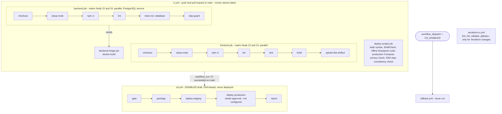

# ShopNest: automated CI/CD for a three-tier application

ShopNest is a small e-commerce product: a React frontend, a Node.js REST API and a PostgreSQL database. This repository replaces ShopNest's
manual, SSH-and-restart deployments with an automated, secure pipeline built on GitHub Actions, and records what has been proven and what has not.

> **Honest status (updated 2026-11-21).** The application, the CI pipeline, the local Docker environment and a local blue/green and rollback
> rehearsal are built and verified. The AWS infrastructure is written as Terraform and passes static checks, but **no AWS resource exists, nothing has been
> deployed, and the CD and rollback workflows have never run.** Zero-downtime and automatic rollback are demonstrated **locally only**.
> The live application URL is **pending** (see [Live URL](#live-url)). Every claim below says whether it is implemented, tested locally, tested on GitHub
> Actions, or still pending. The detailed, per-requirement record is [`docs/REQUIREMENTS_CHECKLIST.md`](docs/REQUIREMENTS_CHECKLIST.md); the overall
> plan is [`docs/PROJECT_EXECUTION_ROADMAP.md`](docs/PROJECT_EXECUTION_ROADMAP.md).

## Contents
1. [Part A: CI/CD concepts for ShopNest management](#part-a-cicd-concepts-for-shopnest-management)
2. [Technology stack](#technology-stack)
3. [Three-tier architecture](#three-tier-architecture)
4. [Repository structure](#repository-structure)
5. [Local development](#local-development)
6. [Testing and validation](#testing-and-validation)
7. [GitHub Actions workflows](#github-actions-workflows)
8. [Secrets and variables](#secrets-and-variables)
9. [Terraform infrastructure](#terraform-infrastructure)
10. [CD architecture and current limitations](#cd-architecture-and-current-limitations)
11. [Zero-downtime strategy and trade-offs](#zero-downtime-strategy-and-trade-offs)
12. [Rollback strategy](#rollback-strategy)
13. [Security practices](#security-practices)
14. [Deployment prerequisites](#deployment-prerequisites)
15. [Troubleshooting](#troubleshooting)
16. [Assignment rubric mapping](#assignment-rubric-mapping)
17. [Evidence and workflow links](#evidence-and-workflow-links)
18. [Live URL](#live-url)

## Part A: CI/CD concepts for ShopNest management

**Continuous Integration (CI)** means every change is merged into the shared branch often and is built and tested automatically each time, so a broken
change is found in minutes, before anyone depends on it.
**Continuous Delivery** extends CI so that every change that passes is automatically packaged and made ready to release, but a person decides when it goes live.
**Continuous Deployment** removes that decision: every change that passes all checks is released to users automatically.
The difference is the last step: Delivery keeps a human approval before production; Deployment has none.

### How the pipeline addresses the four incidents

| Incident | Cause | Pipeline feature | State today |
|---|---|---|---|
| 1. A broken build reached production because nobody ran the tests | deployment was manual and untested | CI runs lint, tests and build for frontend and backend on every pull request and push to `main`; branch protection requires five CI checks before a merge; CD starts only after CI succeeds on the exact commit | CI **tested on GitHub Actions**; branch protection applied; CD gate written, **never run** |
| 2. About 10 minutes of downtime on every deployment | the old release was stopped before the new one started | blue/green: the new release starts beside the old one, is health-checked, and only then receives traffic | **tested locally** only; not on AWS |
| 3. Two hours to restore the previous version, because nobody knew the last good one | no release record | every release is tagged with its commit SHA, a release history records good and failed releases, and automatic and manual rollback scripts restore a known good release | scripts **tested locally**; the rollback workflow **never run** |
| 4. Passwords and keys committed to the repository | secrets in source control | secret scanning (gitleaks) in a pre-commit hook and before every push, GitHub push protection, no credential in any file, short-lived credentials (OIDC) instead of stored keys | scanning **tested**; OIDC is a design, **not built** |

### Approach chosen for ShopNest: Continuous Delivery to production

Planned design (not yet running): a merge to `main` runs CI; after CI passes, the release is deployed automatically to **staging**, and **production
requires a manual reviewer approval** (a GitHub Environment protection rule). This is Continuous Delivery for production, chosen because ShopNest has just had a
bad release: an automated safety net (tests, health checks, rollback) is valuable, but a person should still own the moment production changes.
Staging is continuously deployed. The approval gate is not configured yet.

## Technology stack

| Tier / concern | Technology |
|---|---|
| Presentation | React and Vite, served by Nginx in a container |
| Application | Node.js and Express 5, Zod validation, `pg` |
| Data | PostgreSQL 16 (Docker for local and for the written deployment scripts; private Amazon RDS in the Terraform design) |
| Runtime | Node.js 22 and 24 (tested in CI); local development on Node.js 24 |
| Tests | Vitest, Supertest, React Testing Library |
| Containers | Docker and Docker Compose; third-party images pinned by version and digest |
| Pipelines | GitHub Actions (`ci.yml`, `cd.yml`, `rollback.yml`, `terraform-ci.yml`) |
| Infrastructure | Terraform (AWS, region `ap-south-1`), written, **not applied** |
| Quality and security | ESLint, gitleaks, GitHub secret scanning and push protection |

## Three-tier architecture


- **Presentation:** the React single-page app is built by Vite and served as static files by Nginx. Nginx also proxies `/api/` to the backend.
- **Application:** the Express API exposes `GET /health`, `GET /version` (release version and commit SHA), `GET /api/products`, `GET /api/products/:id`,
  `POST /api/orders` and `GET /api/orders/:id`. It validates input, logs structured JSON and shuts down gracefully.
- **Data:** PostgreSQL holds products and orders. In every Docker environment the database sits on an internal network with no published port. Two database
  roles are used: `shopnest_owner` (migrations) and `shopnest_app` (the API, least-privilege per-table grants).

The diagram shows the application as run locally and by the written deployment scripts (one host, Docker-hosted PostgreSQL). The AWS design differs
(ALB, private RDS, SSM; see [Terraform infrastructure](#terraform-infrastructure)) and is **not yet integrated** with the application code.

## Repository structure

| Path | Contents |
|---|---|
| `frontend/` | React + Vite app, Nginx config, Dockerfile, tests |
| `backend/` | Express API, SQL migrations (`migrations/`), migrate and seed scripts, Dockerfile, tests |
| `deploy/` | Compose files (dev, test, production), Nginx config, blue/green deploy and rollback scripts, offline test suite, per-environment non-secret settings (`env/`) |
| `infra/terraform/` | Terraform for AWS, plus its architecture, security review, remediation log and integration-gap report |
| `.github/workflows/` | `ci.yml`, `cd.yml` (disabled draft), `rollback.yml` (never run), `terraform-ci.yml` |
| `.githooks/` | versioned pre-commit hook that runs gitleaks |
| `docs/` | architecture, GitHub setup, OIDC design, requirements checklist, audit, roadmap, evidence |
| `assignment/` | the assignment brief (kept out of version control) |

## Local development

Prerequisites: Node.js 24 (the code accepts `^22.22.2 || ^24.15.0`), Docker with Compose v2, Git, and [gitleaks](https://github.com/gitleaks/gitleaks) for the commit hook.

1. Enable the secret-scanning hook once per clone: `git config core.hooksPath .githooks` (details: [`docs/GITHUB_SETUP.md`](docs/GITHUB_SETUP.md)).
2. Full local stack (database, migrations, demo data, backend, frontend):
   ```bash
   cp deploy/.env.example deploy/.env      # then edit: set your own local passwords (letters and digits only)
   docker compose -f deploy/docker-compose.dev.yml up --build
   ```
   The frontend is on `http://127.0.0.1:8080` and the API on `http://127.0.0.1:3100` (loopback only). The database has no published port.
   Never commit `deploy/.env`; it is git-ignored.
3. Frontend alone: `cd frontend && npm ci && npm run dev` (Vite proxies `/api` to `127.0.0.1:3100`).
4. Backend alone (against a PostgreSQL you run yourself): `cd backend && npm ci`, copy `backend/.env.example` to `backend/.env` and fill it in. **The backend does not read `.env` by itself** (it has no dotenv dependency), so
   load it explicitly with Node's flag, for example `node --env-file=.env scripts/migrate.js`, `NODE_ENV=development node --env-file=.env scripts/seed.js` and `node --env-file=.env src/server.js`, or export the variables in your shell.
   Migrations and the seed must connect as the owner role (`shopnest_owner`); the running API connects as `shopnest_app`, so use a different `DATABASE_URL` for each.

Configuration is read from environment variables (`PORT`, `HOST`, `DATABASE_URL`, `APP_VERSION`, `GIT_SHA`, `LOG_LEVEL`, pool and timeout settings); see
[`backend/.env.example`](backend/.env.example). Seeding is refused unless `NODE_ENV` is `development` or `test`.

## Testing and validation

| What | Command | Notes |
|---|---|---|
| Frontend lint, test, build | `cd frontend && npm ci && npm run lint && npm test && npm run build` | no database needed |
| Backend lint | `cd backend && npm ci && npm run lint` | |
| Backend tests (unit and API) | `cd backend && npm test` | database integration tests are skipped when `TEST_DATABASE_URL` is unset |
| Backend integration tests | start `deploy/docker-compose.test.yml` (see the header of that file), then `TEST_DATABASE_URL=... npm test --prefix backend` | disposable in-memory database; the database name must end in `_test` |
| Local stack verification | `bash deploy/scripts/verify-stack.sh` | needs Docker; creates and removes its own throwaway Compose project |
| Backend image check | `bash deploy/scripts/verify-backend-build.sh` | needs Docker |
| Blue/green decision logic (offline) | `bash deploy/tests/bluegreen-logic.test.sh` | no Docker needed |
| Local blue/green and rollback rehearsal | `bash deploy/scripts/demo-bluegreen-local.sh --help` | needs a local Docker engine; run only in the throwaway project it creates |

Captured outputs from real runs are in [`docs/evidence/phase2/`](docs/evidence/phase2/). Test counts are not quoted here until a fresh run is saved; the CI run logs are the
source of truth. Some tests were written with AI assistance; the owner is writing the additional tests listed in [`docs/PHASE2_TEST_SPECS.md`](docs/PHASE2_TEST_SPECS.md).

## GitHub Actions workflows



| Workflow | Trigger | State |
|---|---|---|
| `ci.yml` | pull request and push to `main` | **runs and passes**. Jobs: Frontend (Node 22 and 24: install, lint, test, build, upload `dist`), Backend (Node 22 and 24: install, lint, tests against a throwaway PostgreSQL service container, fail if any test was skipped), Backend Docker image (needs Backend), Deploy scripts and Compose (shell syntax, ShellCheck, offline blue/green suite, a check that the production Compose file publishes only Nginx and keeps the database internal, and a check that the SSH steps of `cd.yml` and `rollback.yml` stay identical). The matrix jobs run in parallel |
| `cd.yml` | `workflow_run` after CI on `main` | **disabled draft**; all 6 runs so far (read from GitHub on 2026-11-21) were `skipped` because the variable `CD_ENABLED` is unset. It still uses SSH and has never deployed anything. Its package job downloads the `frontend-dist-node24` artifact that CI uploaded; that hand-off has never executed |
| `rollback.yml` | manual dispatch | written, **never run** (0 runs on GitHub); still SSH-based |
| `terraform-ci.yml` | Terraform-related pushes and pull requests | **runs and passes**; static checks only, no AWS access |

**Required checks** on `main` (branch protection, verified by reading the settings on 2026-11-21): Frontend (Node 22), Frontend (Node 24), Backend (Node 22),
Backend (Node 24), Backend Docker image (each bound to the GitHub Actions app); a pull request is required (0 approvals), branches must be up to date, the rules apply to administrators, and force pushes and branch deletion are disabled
(**verified live configuration**, written read-back: [`docs/evidence/BRANCH_PROTECTION_READBACK_2026-11-21.md`](docs/evidence/BRANCH_PROTECTION_READBACK_2026-11-21.md), not a raw API response or screenshot).
"Deploy scripts and Compose" and the Terraform checks are **not** required: the deployment validation is not yet mature enough to be a mandatory merge gate, so only the five application CI checks are mandatory.
Conversation resolution is intentionally disabled (accepted configuration for a single-maintainer assignment project).
**Project convention:** pull requests are merged with a normal merge commit. Squash and rebase merging remain **enabled** in GitHub, so this is a working convention, not an enforced restriction.
A demonstration of a failing required check blocking a merge is still **pending**.

The CD diagram above is simplified: in the file, `package` needs `gate`, `deploy-staging` needs `gate` and `package`, `deploy-production` needs `gate`, `package` and `deploy-staging`, and `report` needs all four.
All workflows declare explicit `permissions:` and every `uses:` reference is pinned to a commit SHA (checked 2026-11-21).

## Secrets and variables

None of these hold a value in the repository. **Read-only snapshot from 2026-11-21: 0 Actions secrets, 0 Actions variables, 0 Dependabot secrets and 0 GitHub Environments, and `CD_ENABLED` is unset** (recorded in [`docs/evidence/BRANCH_PROTECTION_READBACK_2026-11-21.md`](docs/evidence/BRANCH_PROTECTION_READBACK_2026-11-21.md)). This is a point-in-time state, not a permanent configuration: they will be created when the deployment phases need them. CD stays disabled while `CD_ENABLED` is unset.
The table lists what the current (disabled) workflows reference and what the planned design needs.

| Name | Kind | Purpose | Status |
|---|---|---|---|
| `CD_ENABLED` | variable | switch that lets `cd.yml` and `rollback.yml` run (`true`); unset keeps CD off | referenced; not set |
| `AWS_REGION` | variable | AWS region for the deployment role | referenced; not set |
| `AWS_ROLE_ARN` | variable | role assumed through GitHub OIDC (no stored AWS keys) | referenced; role not created |
| `SSH_SG_ID` | variable | security group opened per run for SSH | obsolete under the SSM design |
| `EC2_HOST`, `EC2_USER` | secrets | deployment target address and user | obsolete under the SSM design |
| `SSH_PRIVATE_KEY`, `SSH_KNOWN_HOSTS` | secrets | SSH deployment key and host key | obsolete under the SSM design |

The planned SSM/ECR design removes the SSH names and adds no AWS access key; the final list will be updated here when the workflows are rewritten.
Separate configuration for staging and production exists as non-secret files in [`deploy/env/`](deploy/env/); GitHub Environments `staging` and `production` were **not yet created** as of the 2026-11-21 snapshot.
Database passwords are never in the repository: locally they come from the untracked `deploy/.env`; in AWS they are meant to come from AWS Secrets Manager (not yet integrated).

## Terraform infrastructure

Status: **written and statically validated (`terraform fmt`, `terraform validate`, Terraform CI). Not planned, not applied. No AWS resource exists.**
Passing validation does not mean AWS will accept the configuration. Region `ap-south-1`; Terraform CLI profile name `devops` locally; no root credentials and no
access keys. Details: [`infra/terraform/README.md`](infra/terraform/README.md), [`ARCHITECTURE.md`](infra/terraform/ARCHITECTURE.md),
[`ARCHITECTURE_SECURITY_REVIEW.md`](infra/terraform/ARCHITECTURE_SECURITY_REVIEW.md), [`REMEDIATION_LOG.md`](infra/terraform/REMEDIATION_LOG.md).

What the configuration describes:
- a VPC with public and private subnets across Availability Zones, an internet gateway and NAT Gateways (one per AZ in production, one in staging, a documented single point of failure for outbound traffic);
- an Application Load Balancer, application EC2 instances (staging 1, production 2) managed through AWS Systems Manager with **no inbound SSH rule**;
- a **private** Amazon RDS PostgreSQL instance (not publicly accessible; Multi-AZ enforced for production), reachable only from the application security group;
- IAM roles intended to be least-privilege (the security review's open findings, including IAM ones, are listed in the remediation log), Amazon ECR repositories, and an encrypted, versioned, private S3 bucket for deployment artifacts.

Not yet done: the Critical and High review findings listed in the remediation log, remote state with locking, CloudWatch, GitHub OIDC roles, HTTPS (HTTP only for now),
and the integration of the application and deployment code with these services. Approximate cost estimates are in section 12 of the Terraform README (an estimate, not a quote).
Applying anything requires the owner's explicit approval.

## CD architecture and current limitations

- **Written (disabled draft):** `cd.yml` verifies CI succeeded for the exact `main` commit, packages a release, deploys to staging, then to production, and reports. It uses SSH and `scp`,
  opens a temporary SSH rule per run, and expects a GitHub Environment with reviewers for production. It has never deployed.
- **Why it will change:** the infrastructure design forbids port 22 and uses SSM Run Command, Amazon ECR images tagged with the commit SHA and a private RDS database. The following is **outstanding**
  ([`infra/terraform/INTEGRATION_GAPS.md`](infra/terraform/INTEGRATION_GAPS.md)): SSM-based deployment and rollback workflows, ECR publishing with recorded digests, backend retrieval of the
  database secret from AWS Secrets Manager with TLS to RDS, database role bootstrap on RDS, a two-instance rolling production deploy, readiness and liveness endpoints, and the GitHub OIDC deploy role.
- **Instructor confirmation pending:** the assignment says deployment is "over SSH"; the design uses SSM instead. This is waiting for the instructor's answer. Until then it is not assumed to be acceptable.

## Zero-downtime strategy and trade-offs

**Strategy: blue/green on the host.** Two backend containers (blue, green) exist; Nginx sends `/api` to the active one. A release starts on the idle colour, must report `/health` OK and `/version`
equal to its commit SHA, and only then does Nginx switch; the old colour keeps running briefly so in-flight requests finish. If validation fails, traffic never moves.
Scripts: [`deploy/scripts/bluegreen-deploy.sh`](deploy/scripts/bluegreen-deploy.sh), [`deploy/scripts/rollback.sh`](deploy/scripts/rollback.sh), [`deploy/nginx/nginx.conf`](deploy/nginx/nginx.conf).

**What was measured (local Docker only, not AWS; release identifiers in the rehearsal are synthetic):**
a deploy during a request loop returned 238 of 238 successful responses, a rejected broken release 107 of 107, and a manual rollback 161 of 161
([`docs/evidence/bluegreen-local/`](docs/evidence/bluegreen-local/)). Zero downtime has **not** been shown on AWS. A fault that appears only after the switch cost about 20 seconds of failed
requests before the automatic rollback (79 of 171 requests in one rehearsal): such a failure is recovered, not invisible.

Trade-offs: two backends run during a deploy (more memory); the database schema must stay compatible with both the old and new release; one host is a single point of failure (the AWS design adds a
second production instance and a rolling deploy, which is not yet written).

## Rollback strategy

- **Automatic:** a release that fails its readiness or post-switch check is rejected or reversed to the last known good release, recorded in the release history. Exit code 1 means failed with the
  previous release serving; exit code 3 means the deploy and the recovery both failed (covered by the offline test suite only).
- **Manual:** `deploy/scripts/rollback.sh` restores a chosen earlier release through the same validation path; the intended entry point is the `rollback.yml` workflow, which has not been run.
- **Database:** schema migrations are never reversed automatically. Recovery from a bad migration is a restore, not an automatic step.
- **Evidence:** local rehearsal only (logs under `docs/evidence/bluegreen-local/`). The staging demonstration required by the assignment is **pending**.

## Security practices

- No credential, key or server address in the repository or its history; gitleaks runs in a versioned pre-commit hook (which must be enabled per clone) and is run manually before every push as a project rule. Evidence: [`docs/evidence/secret-scan/`](docs/evidence/secret-scan/).
  A final all-history scan is required before submission.
- GitHub secret scanning and push protection enabled; branch protection with required checks; no direct pushes to `main`; work goes through feature branches and pull requests.
- No AWS root credentials and no permanent AWS access keys; GitHub OIDC with short-lived credentials is the design (not yet built).
- The database has no published port in the development and production Compose files or in the Terraform design (a CI check enforces this for the production Compose file). The one exception is the disposable test database in `deploy/docker-compose.test.yml`, which is bound to loopback only (`127.0.0.1`). Application containers run as non-root. Third-party images are pinned by version and digest; the application images are tagged per release.
- Workflows use least-privilege `permissions:` and SHA-pinned actions. One deliberate exception: CI's PostgreSQL service container uses trust authentication with no password, because it is a throwaway database that exists only on the runner for the length of one job and holds no real data.

## Deployment prerequisites

Nothing can be deployed to AWS yet. Before a first deployment, all of the following must exist and be approved by the owner: an AWS account profile with short-lived credentials, a reviewed `terraform plan`
and an approved apply, the GitHub OIDC role, GitHub Environments with a production reviewer, the variables listed above, the rewritten SSM/ECR/RDS workflows, and the backend and database integration. The order and
approval points are in [`docs/PROJECT_EXECUTION_ROADMAP.md`](docs/PROJECT_EXECUTION_ROADMAP.md).

## Troubleshooting

| Symptom | Likely cause and action |
|---|---|
| `docker compose` says a variable must be set | create `deploy/.env` from `deploy/.env.example` and set the passwords |
| Database roles look wrong after changing role settings | roles are created only on an empty data volume (`deploy/db/init/01-roles.sh`); recreate the dev volume deliberately with `docker compose -f deploy/docker-compose.dev.yml down -v` (this deletes local data) |
| Integration tests are skipped | `TEST_DATABASE_URL` is not set; the database name must end in `_test` |
| `npm ci` fails on engines | use Node.js 22.22.2 or newer, or 24.15.0 or newer |
| Commit blocked by the hook | gitleaks found something that looks like a secret or address; remove it, never bypass the hook |
| The CD workflow shows "skipped" | expected: `CD_ENABLED` is unset by design |
| A pull request cannot be merged | all five required checks must pass and the branch must be up to date with `main` |

## Assignment rubric mapping

Status words: **Done** = real evidence exists; **Partial** = built, with the gap named; **Pending** = not done. The per-requirement detail is in the [requirements checklist](docs/REQUIREMENTS_CHECKLIST.md) and the
[completion audit](docs/PROJECT_COMPLETION_AUDIT.md).

| Part | Marks | Status | Where |
|---|---|---|---|
| A. CI/CD concepts | 5 | Written in this README; awaiting the owner's review | [Part A](#part-a-cicd-concepts-for-shopnest-management) |
| B. CI pipeline | 15 | Partial: CI passes on GitHub; the owner's own tests and a failing-check demonstration are pending | [workflows](#github-actions-workflows) |
| C. Workflow architecture | 10 | Partial: CI, matrix, parallel jobs, artifact done; CD never run; screenshots pending | [workflows](#github-actions-workflows) |
| D. Secrets and configuration | 10 | Partial: no secrets in the repo; GitHub Environments, approval gate and real secret usage pending | [secrets](#secrets-and-variables) |
| E. Deployment to EC2 | 15 | Pending: Terraform written, nothing deployed | [Terraform](#terraform-infrastructure) |
| F. Zero downtime | 15 | Partial: local evidence only | [strategy](#zero-downtime-strategy-and-trade-offs) |
| G. Monitoring and rollback | 15 | Partial: local evidence only | [rollback](#rollback-strategy) |
| H. Debugging and Copilot | 10 | Pending: the owner's real Copilot session and three failed runs | not started |
| I. Documentation | 5 | Partial: this README; screenshots and a clean-clone dry run pending | this file |

## Evidence and workflow links

Workflow runs on GitHub (repository: <https://github.com/Bhabotos/shopnest-devops-cicd>):

| Run | What it shows |
|---|---|
| [CI 44714705352](https://github.com/Bhabotos/shopnest-devops-cicd/actions/runs/44714705352) | pull request run: frontend and backend on Node 22 and 24 |
| [CI 44786392818](https://github.com/Bhabotos/shopnest-devops-cicd/actions/runs/44786392818) | push to `main`, success |
| [CI 44859967355](https://github.com/Bhabotos/shopnest-devops-cicd/actions/runs/44859967355) | push to `main` after PR #9, success |
| [Terraform CI 44786392731](https://github.com/Bhabotos/shopnest-devops-cicd/actions/runs/44786392731) | static Terraform checks, success |
| [CD 44860058198](https://github.com/Bhabotos/shopnest-devops-cicd/actions/runs/44860058198) | CD **skipped** (disabled by design) |

Local evidence: [`docs/evidence/phase2/`](docs/evidence/phase2/) (lint, tests, build, stack verification, secret scans) and
[`docs/evidence/bluegreen-local/`](docs/evidence/bluegreen-local/) (blue/green and rollback rehearsal; **local, not AWS**).
Screenshots of runs and settings are **pending** and will be added under `docs/screenshots/`; no screenshot is claimed here.
No failed pipeline run exists yet; the three required failure scenarios and the Copilot evidence are pending.

## Live URL

**Pending.** The application is not deployed, so there is no live address. Whether and how an address may appear in this repository, given the rule that no server address may be committed,
is waiting for the instructor's clarification. No address will be written here until that is resolved.
