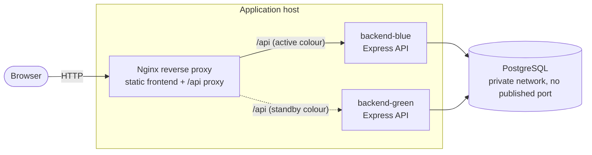
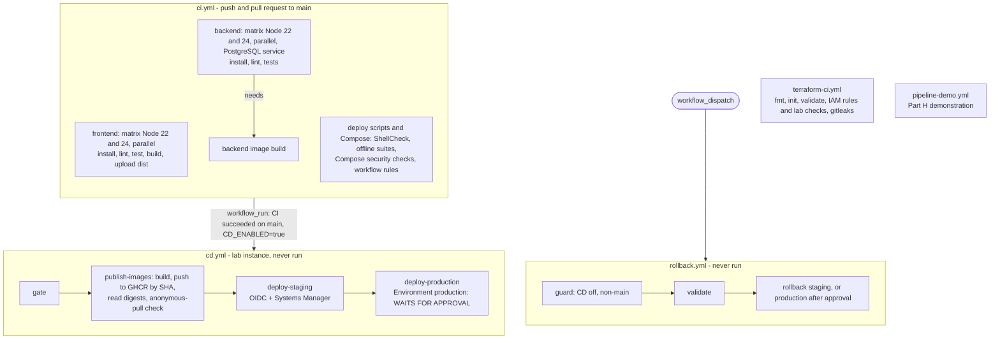

# ShopNest: automated CI/CD for a three-tier application

ShopNest is a small e-commerce product: a React frontend, a Node.js REST API and a PostgreSQL database. This repository replaces ShopNest's
manual, SSH-and-restart deployments with an automated, secure pipeline built on GitHub Actions, and records what has been proven and what has not.

> **Honest status (updated 2026-11-23).** The application, the CI pipeline, the local Docker environment and a local blue/green and rollback
> rehearsal are built and verified. The **deployment target is now a minimal lab instance** (one EC2 `t3.small`, Systems Manager instead of SSH, PostgreSQL in a Docker container, images on GHCR, no NAT Gateway, load balancer, RDS or ECR):
> see [`infra/lab/README.md`](infra/lab/README.md) and [`docs/LAB_DEPLOYMENT.md`](docs/LAB_DEPLOYMENT.md). It is **written as code and tested offline only: no AWS resource exists, nothing has been deployed, no Terraform plan has been made for it, and
> the CD and rollback workflows have never executed their deploy jobs** (every CD run so far was skipped). Zero downtime, automatic rollback on the instance, and the live URL are
> **not proven**; the blue/green rehearsal was done on local Docker only. The earlier, larger AWS design in `infra/terraform/` (RDS, ECR, ALB, NAT, CodeBuild) stays in the repository for reference and is no longer used by the deployment workflows.
> The live application URL is **pending** (see [Live URL](#live-url)). Every claim below says whether it is implemented, tested locally, tested on GitHub
> Actions, or still pending. The per-requirement record is [`docs/REQUIREMENTS_CHECKLIST.md`](docs/REQUIREMENTS_CHECKLIST.md).

## Contents
1. [Part A: CI/CD concepts for ShopNest management](#part-a-cicd-concepts-for-shopnest-management)
2. [Technology stack](#technology-stack)
3. [Three-tier architecture](#three-tier-architecture)
4. [Repository structure](#repository-structure)
5. [Local development](#local-development)
6. [Testing and validation](#testing-and-validation)
7. [GitHub Actions workflows](#github-actions-workflows)
8. [Secrets and variables](#secrets-and-variables)
9. [Terraform infrastructure](#terraform-infrastructure)
10. [CD architecture and current limitations](#cd-architecture-and-current-limitations)
11. [Zero-downtime strategy and trade-offs](#zero-downtime-strategy-and-trade-offs)
12. [Rollback strategy](#rollback-strategy)
13. [Security practices](#security-practices)
14. [Deployment prerequisites](#deployment-prerequisites)
15. [Troubleshooting](#troubleshooting)
16. [Assignment rubric mapping](#assignment-rubric-mapping)
17. [Evidence and workflow links](#evidence-and-workflow-links)
18. [Live URL](#live-url)

## Part A: CI/CD concepts for ShopNest management

**Continuous Integration (CI)** means every change is merged into the shared branch often and is built and tested automatically each time, so a broken
change is found in minutes, before anyone depends on it.
**Continuous Delivery** extends CI so that every change that passes is automatically packaged and made ready to release, but a person decides when it goes live.
**Continuous Deployment** removes that decision: every change that passes all checks is released to users automatically.
The difference is the last step: Delivery keeps a human approval before production; Deployment has none.

### How the pipeline addresses the four incidents

| Incident | Cause | Pipeline feature | State today |
|---|---|---|---|
| 1. A broken build reached production because nobody ran the tests | deployment was manual and untested | CI runs lint, tests and build for frontend and backend on every pull request and push to `main`; branch protection requires five CI checks before a merge; CD starts only after CI succeeds on the exact commit, and a failed database migration stops the deployment | CI **tested on GitHub Actions**; branch protection applied; the CD gate and migration stop are written and tested offline, **never run** |
| 2. About 10 minutes of downtime on every deployment | the old release was stopped before the new one started | blue/green: the new release starts beside the old one, is health-checked, and only then receives traffic | **tested on local Docker** only; not on AWS |
| 3. Two hours to restore the previous version, because nobody knew the last good one | no release record | every release is tagged with its commit SHA, the image is recorded by digest, a release history records good and failed releases, and automatic and manual rollback restore a known good release | scripts **tested locally and offline**; the rollback workflow **never run** |
| 4. Passwords and keys committed to the repository | secrets in source control | secret scanning (gitleaks) in a pre-commit hook and before every push, GitHub push protection, no credential in any file, no GitHub secrets at all in the deployment workflows, short-lived credentials (OIDC) instead of stored keys, database secrets in AWS Secrets Manager | scanning **tested**; OIDC and Secrets Manager are **written as code, not applied** |

### Approach chosen for ShopNest: Continuous Delivery to production

Planned design (not yet running): a merge to `main` runs CI; after CI passes, the release is deployed automatically to **staging**, and **production
requires a manual reviewer approval** (a GitHub Environment protection rule). This is Continuous Delivery for production, chosen because ShopNest has just had a
bad release: an automated safety net (tests, health checks, rollback) is valuable, but a person should still own the moment production changes.
Staging is continuously deployed. **Production deployment and its approval gate are not implemented**: the CD workflow deploys staging only and says so in its run summary.

## Technology stack

| Tier / concern | Technology |
|---|---|
| Presentation | React and Vite, served by Nginx in a container |
| Application | Node.js and Express 5, Zod validation, `pg`, the AWS SDK (Secrets Manager client) |
| Data | PostgreSQL 16 in a Docker container on an internal network (locally, and in the lab instance's two environments); the earlier AWS design used a private Amazon RDS instance |
| Runtime | Node.js 22 and 24 (tested in CI); local development on Node.js 24 |
| Tests | Vitest, Supertest, React Testing Library; offline shell suites with fake Docker and fake AWS |
| Containers | Docker and Docker Compose; third-party images pinned by version and digest; the application images are published to **GHCR** tagged with the commit SHA and deployed by digest |
| Pipelines | GitHub Actions (`ci.yml`, `cd.yml`, `rollback.yml`, `terraform-ci.yml`, and the Part H demonstration workflow `pipeline-demo.yml`) |
| Infrastructure | Terraform (AWS, region `ap-south-1`), `infra/lab/`: a dedicated VPC, one public subnet, an Internet Gateway, one `t3.small` with a public address, HTTP 80 inbound only; no NAT Gateway, load balancer, RDS or ECR. The earlier, larger design in `infra/terraform/` is kept for reference. Written, **not applied** |
| Deployment mechanism | SSH through an AWS Systems Manager port-forwarding tunnel (no inbound port 22): each Environment has its own forced-command key that can start only two root-owned wrappers on the instance; GitHub Actions authenticates to AWS through OIDC and the images are pulled from GHCR by digest; written and tested offline, **never run on the instance** |
| Quality and security | ESLint, ShellCheck, actionlint, gitleaks, GitHub secret scanning and push protection |

## Three-tier architecture



- **Presentation:** the React single-page app is built by Vite and served as static files by Nginx. Nginx also proxies `/api/` to the backend.
- **Application:** the Express API exposes `GET /health`, `GET /version` (release version and commit SHA), `GET /api/products`, `GET /api/products/:id`,
  `POST /api/orders` and `GET /api/orders/:id`. It validates input, logs structured JSON and shuts down gracefully.
- **Data:** PostgreSQL holds products and orders. In every Docker environment the database sits on an internal network with no published port. Two database
  roles are used: `shopnest_owner` (migrations) and `shopnest_app` (the API, least-privilege per-table grants).

The diagram shows the application as run locally and in the laptop rehearsal (one host, Docker-hosted PostgreSQL).

### On AWS: the lab instance (written, not deployed)


Both environments run on the one instance as separate Compose projects; **only production is public** (port 80), staging listens on the loopback address and is reached through Session Manager. The databases have no published port and sit on an
internal Docker network. Details, limits and the proof status: [`docs/LAB_DEPLOYMENT.md`](docs/LAB_DEPLOYMENT.md). GitHub renders these diagrams from the Mermaid source; rendering on GitHub has **not** been checked.

## Repository structure

| Path | Contents |
|---|---|
| `frontend/` | React + Vite app, Nginx config, Dockerfile, tests |
| `backend/` | Express API, SQL migrations (`migrations/`), migrate, seed, bootstrap and connectivity scripts, the pinned RDS CA bundle (`certs/`), Dockerfile, tests |
| `deploy/` | Compose files (dev, test, AWS production, and a laptop-rehearsal database file), Nginx config, blue/green deploy and rollback scripts, `ci/` (CI-side helpers), `host/` (metadata-service guard and systemd units), `codebuild/` (build specifications), offline test suites, per-environment non-secret settings (`env/`) |
| `infra/terraform/` | Terraform for AWS, plus its architecture, security review, remediation log and integration-gap report |
| `.github/workflows/` | `ci.yml`, `cd.yml`, `rollback.yml`, `terraform-ci.yml`, `pipeline-demo.yml` (Part H demonstration) |
| `.githooks/` | versioned pre-commit hook that runs gitleaks |
| `docs/` | AWS staging integration, architecture, GitHub setup, OIDC design, requirements checklist, audit, roadmap, Copilot and run evidence, and the Part H failure write-up (`docs/failures/`) |
| `assignment/` | the assignment brief (kept out of version control) |

## Local development

Prerequisites: Node.js 24 (the code accepts `^22.22.2 || ^24.15.0`), Docker with Compose v2, Git, and [gitleaks](https://github.com/gitleaks/gitleaks) for the commit hook.

1. Enable the secret-scanning hook once per clone: `git config core.hooksPath .githooks` (details: [`docs/GITHUB_SETUP.md`](docs/GITHUB_SETUP.md)).
2. Full local stack (database, migrations, demo data, backend, frontend):
   ```bash
   cp deploy/.env.example deploy/.env      # then edit: set your own local passwords (letters and digits only)
   docker compose -f deploy/docker-compose.dev.yml up --build
   ```
   The frontend is on `http://127.0.0.1:8080` and the API on `http://127.0.0.1:3100` (loopback only). The database has no published port.
   Never commit `deploy/.env`; it is git-ignored.
3. Frontend alone: `cd frontend && npm ci && npm run dev` (Vite proxies `/api` to `127.0.0.1:3100`).
4. Backend alone (against a PostgreSQL you run yourself): `cd backend && npm ci`, copy `backend/.env.example` to `backend/.env` and fill it in. **The backend does not read `.env` by itself** (it has no dotenv dependency), so
   load it explicitly with Node's flag, for example `node --env-file=.env scripts/migrate.js`, `NODE_ENV=development node --env-file=.env scripts/seed.js` and `node --env-file=.env src/server.js`, or export the variables in your shell.
   Migrations and the seed must connect as the owner role (`shopnest_owner`); the running API connects as `shopnest_app`, so use a different `DATABASE_URL` for each.

Configuration is read from environment variables (`PORT`, `HOST`, `DATABASE_URL`, `APP_VERSION`, `GIT_SHA`, `LOG_LEVEL`, pool and timeout settings); see
[`backend/.env.example`](backend/.env.example). Seeding is refused unless `NODE_ENV` is `development` or `test` (or `production` with an explicit flag).

**Two database modes.** Locally the backend uses `DATABASE_URL`. On AWS it uses **no** `DATABASE_URL`: it reads its user and password from AWS Secrets Manager and connects to RDS over TLS, verifying the
server certificate against the pinned bundle in `backend/certs/`. The two modes are mutually exclusive and the backend refuses to start if both are set. The laptop blue/green rehearsal
(`deploy/docker-compose.local-db.yml`) is for local use only and is refused for staging and production.

## Testing and validation

| What | Command | Notes |
|---|---|---|
| Frontend lint, test, build | `cd frontend && npm ci && npm run lint && npm test && npm run build` | no database needed |
| Backend lint | `cd backend && npm ci && npm run lint` | |
| Backend tests (unit and API) | `cd backend && npm test` | database integration tests are skipped when `TEST_DATABASE_URL` is unset |
| Backend integration tests | start `deploy/docker-compose.test.yml` (see the header of that file), then `TEST_DATABASE_URL=... npm test --prefix backend` | disposable in-memory database; the database name must end in `_test` |
| Blue/green decision logic (offline) | `bash deploy/tests/bluegreen-logic.test.sh` | fake Docker and fake AWS; no containers; takes several minutes |
| Metadata-guard rules (offline) | `bash deploy/tests/imds-guard.test.sh` | fake `iptables` and Docker; no root |
| CI helpers (offline) | `bash deploy/tests/ci-helpers.test.sh` | bundle, image push, migrator and Systems Manager runner, against fake AWS |
| Workflow security rules (static) | `bash deploy/tests/workflows.test.sh` | reads the workflow files; needs Python with PyYAML |
| Terraform IAM and gating (static; the earlier design) | `bash deploy/tests/terraform-iam.test.sh` | reads the `.tf` files of `infra/terraform`; no Terraform or AWS |
| Lab deploy and rollback decisions (offline) | `bash deploy/tests/lab-mode.test.sh` | fake Docker; no containers; digests, generated passwords, loopback staging, refused releases, rollback re-pull |
| Lab Terraform architecture (static) | `bash deploy/tests/lab.test.sh` | reads `infra/lab`; no Terraform or AWS |
| Terraform format and validity | `cd infra/terraform && terraform fmt -check -recursive && terraform validate` | needs an initialised working directory; contacts nothing |
| Local stack verification | `bash deploy/scripts/verify-stack.sh` | needs Docker; creates and removes its own throwaway Compose project |
| Backend image check | `bash deploy/scripts/verify-backend-build.sh` | needs Docker |
| Local blue/green and rollback rehearsal | `bash deploy/scripts/demo-bluegreen-local.sh --help` | needs a local Docker engine; run only in the throwaway project it creates; **not re-run since the AWS-mode changes** |

**Results (2026-11-21, local and offline). The same suites also ran, and passed, in the GitHub Actions job "Deploy scripts and Compose" and in Terraform CI on pull requests #24, #25 and #26; the counts below are from the local runs:**

| Suite | Result |
|---|---|
| Backend (Vitest) | 160 passed, 0 failed, 11 skipped (the PostgreSQL integration tests, which need a live database); ESLint clean |
| Blue/green offline suite | 305 passed, 0 failed |
| Metadata-guard suite | 135 passed, 0 failed |
| CI-helper suite | 146 passed, 0 failed |
| Workflow static checks | 68 passed, 0 failed |
| Terraform static IAM checks | 97 passed, 0 failed |
| `terraform fmt` and `validate` | pass |
| ShellCheck (every shell file under `deploy/`) and actionlint (every workflow) | clean |

These prove decisions and rules against fakes. They do **not** prove behaviour on real containers, real iptables, or AWS. The last CI results from GitHub Actions are in [Evidence](#evidence-and-workflow-links);
earlier captured outputs from real local runs are in [`docs/evidence/phase2/`](docs/evidence/phase2/). Some tests were written with AI assistance; the owner is writing the additional tests listed in
[`docs/PHASE2_TEST_SPECS.md`](docs/PHASE2_TEST_SPECS.md).

## GitHub Actions workflows



| Workflow | Trigger | State |
|---|---|---|
| `ci.yml` | pull request and push to `main` | **runs and passes on GitHub** (on the pull requests #22 to #26 and on the pushes to `main`). Jobs: Frontend (Node 22 and 24: install, lint, test, build, upload `dist`), Backend (Node 22 and 24: install, lint, tests against a throwaway PostgreSQL service container, fail if any test was skipped), Backend Docker image (needs Backend), Deploy scripts and Compose (shell syntax, ShellCheck, the offline blue/green, metadata-guard and CI-helper suites, AWS-mode and rehearsal-mode Compose security assertions, the deployment-workflow rules). The matrix jobs run in parallel. The updated "Deploy scripts and Compose" job ran and passed on pull requests #24 to #26 (its first run on #26 failed on one test assertion that depended on a Git file mode; the assertion was corrected and the failed run is kept in the Actions history) |
| `cd.yml` | `workflow_run` after CI on `main` | **rewritten for the lab instance; its deploy jobs have never executed.** Every run so far was `skipped` because the variable `CD_ENABLED` is unset. Jobs: `gate` (CI succeeded for the exact commit, still the tip of `main`), `publish-images` (build backend and frontend images, push to GHCR tagged with the commit SHA, read back the digests, check an anonymous pull), `deploy-staging` (Environment `staging`, SSH through the SSM tunnel), `deploy-production` (Environment `production`, held for the reviewer's approval). SSH only through the pinned SSM tunnel (no inbound port 22), one secret per Environment (`DEPLOY_SSH_KEY`), AWS access by OIDC. **Tested offline and statically only** |
| `rollback.yml` | manual dispatch | **rewritten for staging and production on the lab instance; never run.** It **fails closed**: a request while `CD_ENABLED` is not `true`, from a ref other than `main`, or for an unknown environment is refused with an error. The job is bound to the chosen Environment, so a production rollback needs the reviewer's approval. It never runs migrations |
| `terraform-ci.yml` | Terraform-related pushes and pull requests | runs static checks only, no AWS access (format, init without a backend, validate, secret scan) for `infra/terraform` and, in a separate job, for `infra/lab` plus the lab architecture checks |
| `pipeline-demo.yml` | push to `demo/**` and manual dispatch | the Part H demonstration workflow (generated with GitHub Copilot, per the owner's records in `docs/copilot/`); see [Evidence](#evidence-and-workflow-links) |

**Required checks** on `main` (branch protection, verified by reading the settings on 2026-11-21): Frontend (Node 22), Frontend (Node 24), Backend (Node 22),
Backend (Node 24), Backend Docker image (each bound to the GitHub Actions app); a pull request is required (0 approvals), branches must be up to date, the rules apply to administrators, and force pushes and branch deletion are disabled
(**verified live configuration**, written read-back: [`docs/evidence/BRANCH_PROTECTION_READBACK_2026-11-21.md`](docs/evidence/BRANCH_PROTECTION_READBACK_2026-11-21.md), not a raw API response; the settings screenshots in [`docs/screenshots/part-h/`](docs/screenshots/part-h/) are **partial**).
"Deploy scripts and Compose" and the Terraform checks are **not** required: the deployment validation is not yet mature enough to be a mandatory merge gate, so only the five application CI checks are mandatory.
Conversation resolution is intentionally disabled (accepted configuration for a single-maintainer assignment project).
**Project convention:** pull requests are merged with a normal merge commit. Squash and rebase merging remain **enabled** in GitHub, so this is a working convention, not an enforced restriction.
A failing required check was demonstrated on [PR #28](https://github.com/Bhabotos/shopnest-devops-cicd/pull/28): a deliberate failing test made both Backend checks fail and the Docker-image check skip, and GitHub reported the merge as blocked
(observed through the GitHub API). **There is no screenshot of the blocked merge**, because the checks are green now. PR #28 is an intentionally open failure demonstration and **must not be merged**.

All workflows declare explicit `permissions:` and every `uses:` reference is pinned to a commit SHA; a static check enforces this for the deployment workflows.

## Secrets and variables

**The one secret in the deployment path is each Environment's `DEPLOY_SSH_KEY`** (a different ed25519 key per Environment, bound to its Environment on the host). Images are pushed to GHCR with the run's own short-lived `GITHUB_TOKEN`, AWS access comes from GitHub OIDC (short-lived credentials), and the database passwords are **generated on the instance**
at the first deploy (mode 600, never printed, never stored elsewhere). Nothing below holds a value in the repository.
GitHub Environments `staging` and `production` exist (main-only; `production` requires the reviewer `Bhabotos`, administrator bypass off; recorded 2026-11-23 with 0 variables and 0 secrets). Creating the variables below is a GitHub
settings change that needs separate approval; CD stays disabled while `CD_ENABLED` is unset.

| Name | Kind | Purpose | Status |
|---|---|---|---|
| `CD_ENABLED` | repository variable | master switch: unless exactly `true`, CD is skipped and a rollback request is refused | not set |
| `AWS_ROLE_ARN` | variable of each Environment (`staging`, `production`) | the OIDC deploy role of that Environment (it can only open an SSM port-forwarding session to the instance) | set on both (names verified 2026-11-24) |
| `AWS_REGION` | variable of each Environment | the AWS region (`ap-south-1`) | set on both |
| `LAB_INSTANCE_ID` | variable of each Environment | the lab instance the tunnel targets | set on both |
| `SSH_HOST_KEY` | variable of each Environment | the instance's PUBLIC SSH host key, pinned so strict host-key checking stays on | set on both |
| `DEPLOY_SSH_KEY` | **secret** of each Environment | that Environment's private deploy key (staging and production differ) | set on both (name verified; value never read) |
| `GITHUB_TOKEN` | automatic, per run (not a stored secret) | pushes the images to GHCR (`packages: write` in one job only) | in the workflow design |

Terraform-side values (never committed; both files are git-ignored): `allowed_account_ids` in `infra/lab/lab.tfvars`, and the state bucket name in `infra/lab/backend.hcl`.
The earlier SSH names (`SSH_PRIVATE_KEY`, `SSH_KNOWN_HOSTS`, `EC2_HOST`, `EC2_USER`, `SSH_SG_ID`) and the earlier AWS-design names (`ECR_REPOSITORY`, `ARTIFACT_BUCKET`, `MIGRATOR_PROJECT`, `STAGING_INSTANCE_ID`) are **obsolete**; a CI check fails if any reappears in `cd.yml` or `rollback.yml`.
Separate configuration for staging and production exists as non-secret files in [`deploy/env/`](deploy/env/) and as separate GitHub Environments, each with its own variables and its own AWS role.

## Terraform infrastructure

Status: **`infra/lab/` is written and statically validated (`terraform fmt`, `terraform validate`, 64 static architecture checks). Not planned, not applied. No AWS resource exists.**
Passing validation does not mean AWS will accept the configuration. Region `ap-south-1`; Terraform CLI profile name `devops` locally; no root credentials and no access keys. Details: [`infra/lab/README.md`](infra/lab/README.md).

What `infra/lab/` describes:
- a dedicated VPC, **one public subnet**, an Internet Gateway and a route table (no NAT Gateway);
- **one `t3.small`** with a public IPv4 address (an Elastic IP by default), a security group that admits **TCP 80 only** (port 22 closed: no inbound SSH, no HTTPS, no database port), IMDSv2, an encrypted root volume and no key pair;
- a new instance role that can only use Systems Manager; Docker, Compose and git installed at first boot;
- **optional, off by default (`enable_cicd = false`):** one GitHub OIDC deploy role per Environment and four fixed Systems Manager command documents;
- remote state in an **existing** S3 bucket (key `terraform/shopnest/terraform.tfstate`, encryption on, S3 lock file); the bucket name is supplied from an untracked file.

Not created: NAT Gateway, load balancer, RDS, ECR, a state bucket, a key pair, any access key. The earlier design in [`infra/terraform/`](infra/terraform/README.md) (RDS, ECR, ALB, NAT, CodeBuild) is **unchanged and unused by the deployment workflows**; its saved plan
files are stale and must never be applied. Approximate cost of the lab: about $21 to $26 a month (an estimate, not a quote; see `infra/lab/README.md`).

## CD architecture and current limitations

- **Written, never run:** `cd.yml` verifies CI succeeded for the exact `main` commit, builds the backend and frontend images, pushes both to **GHCR** tagged with the commit SHA and reads back their **digests**, checks that the packages can be pulled
  anonymously, and deploys over **SSH through a Systems Manager port-forwarding tunnel** (no inbound port 22): it fetches the repository at that commit, pulls both images by digest, applies the migrations, and runs the blue/green deploy with automatic rollback.
  Exit codes 0, 1 and 3 come back unchanged; code 4 means the result could not be confirmed. The sequence, with a diagram, is in [`docs/LAB_DEPLOYMENT.md`](docs/LAB_DEPLOYMENT.md).
- **Production** is deployed by `deploy-production` only, which is bound to the `production` Environment (GitHub holds it until the reviewer approves) and runs only after staging deployed. **Not yet demonstrated on a real deployment.**
- **Never run against AWS.** The behaviour is covered by offline tests with fakes (see [Testing](#testing-and-validation)), not by any real run.
- **Manual GitHub steps remain:** make the two GHCR packages public (one time), capture the real OIDC subject claims, set the Environment variables, then set `CD_ENABLED`.
- **Instructor confirmation pending:** the assignment says deployment is "over SSH"; the design uses Systems Manager instead (the owner's decision). The instructor has not confirmed it, so it is a **risk to Part E**. The live-URL rule (Part D forbids a server
  address in the repository, while the assignment asks for a live URL) is likewise the owner's decision, not the instructor's.

## Zero-downtime strategy and trade-offs

**Strategy: blue/green on the host.** Two backend containers (blue, green) exist; Nginx sends `/api` to the active one. A release starts on the idle colour, must report `/health` OK and `/version`
equal to its commit SHA, and only then does Nginx switch; the old colour keeps running briefly so in-flight requests finish. If validation fails, traffic never moves.
Scripts: [`deploy/scripts/bluegreen-deploy.sh`](deploy/scripts/bluegreen-deploy.sh), [`deploy/scripts/rollback.sh`](deploy/scripts/rollback.sh), [`deploy/nginx/nginx.conf`](deploy/nginx/nginx.conf).

**What was measured (local Docker only, not AWS; release identifiers in the rehearsal are synthetic):**
a deploy during a request loop returned 238 of 238 successful responses, a rejected broken release 107 of 107, and a manual rollback 161 of 161
([`docs/evidence/bluegreen-local/`](docs/evidence/bluegreen-local/)). That rehearsal **predates the AWS-mode changes** (private RDS, ECR digests, the metadata guard) and has not been repeated since.
**Zero downtime has not been shown on AWS.** A fault that appears only after the switch cost about 20 seconds of failed
requests before the automatic rollback (79 of 171 requests in one rehearsal): such a failure is recovered, not invisible.

Trade-offs: two backends run during a deploy (more memory); the database schema must stay compatible with both the old and new release; one host is a single point of failure (the AWS design adds a
second production instance and a rolling deploy, which is not yet written).

## Rollback strategy

- **Automatic:** a release that fails its readiness or post-switch check is rejected or reversed to the last known good release, recorded in the release history.
- **Manual:** `rollback.yml` (staging, or production after the reviewer's approval) sends a fixed Systems Manager document that runs `deploy/scripts/rollback.sh` from the current `main`. It refuses a release that is not recorded as deployed, pulls the **recorded image digests** (backend and frontend)
  again from GHCR if the host lost them, and moves traffic only after the release passes the same validation as a deploy. It is **never run**.
- **Exit codes:** `0` success; `1` failed with the previous release serving (or restored); `2` bad arguments; `3` the deploy or rollback **and** the recovery failed, which needs an operator now; `4` the result could not be confirmed
  (treat as failed). Codes 1 and 3 are covered by the offline suites only; **no real code 3 has been observed**.
- **Database:** a rollback **never runs migrations** and **never reverses the schema**. Recovery from a bad migration is a fix-forward migration or restoring the database volume (the lab instance keeps no backup: demo data).
- **Evidence:** local rehearsal and offline tests only. The demonstration required by the assignment (a deliberately broken release recovering by itself) is **pending** a real deployment.

## Security practices

- No credential, key or server address in the repository or its history; gitleaks runs in a versioned pre-commit hook (which must be enabled per clone) and is run manually before every push as a project rule. Evidence: [`docs/evidence/secret-scan/`](docs/evidence/secret-scan/).
  The scanner's IPv4 rule has two deliberate, narrow exceptions beyond loopback (approved 2026-11-21): the project's own private container network and the documented EC2 metadata address, neither of which is a server address.
  A final all-history scan is required before submission.
- GitHub secret scanning and push protection enabled; branch protection with required checks; no direct pushes to `main`; work goes through feature branches and pull requests.
- No AWS root credentials, no permanent AWS access keys and only one GitHub secret per Environment (`DEPLOY_SSH_KEY`) in the deployment path: GHCR pushes use the run's own token, AWS access is GitHub OIDC with short-lived credentials, trust pinned to an exact Environment subject. The roles and the instance exist (read-only checks, 2026-11-24); **no deploy has run**.
- Least-privilege identities by design: the instance role can only use Systems Manager; each Environment's deploy role can send only that Environment's two fixed documents to the one instance and cannot read a secret or change infrastructure. Enforced by static checks on the Terraform source (`deploy/tests/lab.test.sh`); **not tested against AWS**.
- The deployment workflows are SSM-only; a static check fails if SSH, a stored credential, an unpinned action, or an expression inside a script reappears.
- **Metadata service:** in the lab the instance's metadata hop limit is 1, so no container can reach the instance role at all (the containers need no AWS credential: images and code are public). The earlier design's host firewall guard is not used by the lab. **Not verified on a real instance.**
  A compromised backend would still hold the instance role (residual risk, documented). This is **not verified on a real instance**; see [section 7 of the AWS document](docs/AWS_STAGING_INTEGRATION.md#7-metadata-service-imds-isolation).
- The database has no published port in the development Compose file, in the lab Compose configuration (checked in CI with `docker compose config`) or in the Terraform design, and the lab's security group admits only port 80. The one exception is the disposable test database in `deploy/docker-compose.test.yml`, which is bound to loopback only (`127.0.0.1`). Application containers run as non-root. Third-party images are pinned by version and digest; the application images are tagged per release and deployed by digest.
- The lab uses a PostgreSQL container, so there is no RDS TLS to verify; the database is reachable only on the internal Docker network. The earlier design's RDS CA bundle is unchanged and unused by the lab.
- Workflows use least-privilege `permissions:` and SHA-pinned actions. One deliberate exception: CI's PostgreSQL service container uses trust authentication with no password, because it is a throwaway database that exists only on the runner for the length of one job and holds no real data.

## Deployment prerequisites

Nothing can be deployed to AWS yet. Before a first deployment, all of the following must exist and be approved by the owner: the AWS profile `devops` with short-lived credentials, the **verified** existing state bucket, an untracked `backend.hcl` and `lab.tfvars`,
a **reviewed** `terraform plan` and an approved apply of `infra/lab` (the saved plans in `infra/terraform` must never be used), the real OIDC subject claims, the two GHCR packages set to public, the Environment variables listed above, and finally `CD_ENABLED=true`.
The exact order is in [`infra/lab/README.md`](infra/lab/README.md) and [`docs/LAB_DEPLOYMENT.md`](docs/LAB_DEPLOYMENT.md).

## Troubleshooting

| Symptom | Likely cause and action |
|---|---|
| `docker compose` says a variable must be set | create `deploy/.env` from `deploy/.env.example` and set the passwords |
| Database roles look wrong after changing role settings | roles are created only on an empty data volume (`deploy/db/init/01-roles.sh`); recreate the dev volume deliberately with `docker compose -f deploy/docker-compose.dev.yml down -v` (this deletes local data) |
| Integration tests are skipped | `TEST_DATABASE_URL` is not set; the database name must end in `_test` |
| `npm ci` fails on engines | use Node.js 22.22.2 or newer, or 24.15.0 or newer |
| Commit blocked by the hook | gitleaks found something that looks like a secret or address; remove it, never bypass the hook |
| The CD workflow shows "skipped" | expected: `CD_ENABLED` is unset by design |
| The Rollback workflow fails immediately | expected when it refuses the request: production, `CD_ENABLED` not `true`, or a ref other than `main`; it never ignores a request |
| The backend refuses to start: "set either DATABASE_URL or the RDS settings" | both modes are configured; use `DATABASE_URL` locally, or the RDS settings on AWS, never both |
| A deploy stops with "FAIL CLOSED" | the metadata-service isolation could not be confirmed; no release was started; nothing is serving a new release. Fix the guard before retrying |
| A deploy stops at the migrator | the migration failed or the database roles do not exist yet (the first deploy attempt does this by design); nothing was deployed |
| A workflow step reports exit code 4 | the result could not be confirmed (timeout, cancelled, unexpected code); check the instance before retrying |
| A pull request cannot be merged | all five required checks must pass and the branch must be up to date with `main` |

## Assignment rubric mapping

Status words: **Done** = real evidence exists; **Partial** = built, with the gap named; **Pending** = not done. The per-requirement detail is in the [requirements checklist](docs/REQUIREMENTS_CHECKLIST.md) and the
[completion audit](docs/PROJECT_COMPLETION_AUDIT.md).

| Part | Marks | Status | Where |
|---|---|---|---|
| A. CI/CD concepts | 5 | Written in this README; awaiting the owner's review | [Part A](#part-a-cicd-concepts-for-shopnest-management) |
| B. CI pipeline | 15 | Partial: CI passes on GitHub; a failing required check blocking a merge is demonstrated by the deliberate failing test on PR #28 (the failed and recovered runs are in `docs/screenshots/part-h/`; the blocked-merge view itself was not captured); the owner's own tests are pending | [workflows](#github-actions-workflows) |
| C. Workflow architecture | 10 | Partial: CI, matrix, parallel jobs, artifact done; the rewritten CD never run; screenshots partial (the CI job graph appears in the Part H screenshots; no CD run exists to show) | [workflows](#github-actions-workflows) |
| D. Secrets and configuration | 10 | Partial: no secrets in the repo; the OIDC deploy roles (one per Environment) exist in AWS (read-only check, 2026-11-24). GitHub Environments `staging` and `production` are configured (main-only; `production` requires reviewer `Bhabotos`; 4 variables and the `DEPLOY_SSH_KEY` secret per Environment, names verified 2026-11-24). **Manual approval demonstrated with a separate demonstration workflow only:** `approval-demo` run [45128964969](https://github.com/Bhabotos/shopnest-devops-cicd/actions/runs/45128964969) (commit `3738e0bb22f4e67164abecec11d0f7a58779216b`, `main`) paused at "Waiting for review", was approved by `Bhabotos`, and finished `success`. It deploys nothing and touches no AWS; the `production-approval` job in `cd.yml` has never run, and no real secret usage or production deployment exists. Screenshots in the repository: [waiting for review](docs/screenshots/part-d/waiting%20.png) and [approved, success](docs/screenshots/part-d/Human%20Approval.png) (neither shows the run ID in a URL; the run page title `approval-demo #1`, commit `3738e0b`, the approval by `Bhabotos` and the success status are visible, and the run ID is confirmed by the GitHub API record). Missing: a screenshot of the Environment settings page | [secrets](#secrets-and-variables) |
| E. Deployment to EC2 | 15 | Pending: the instance, the roles and the Environment configuration exist, and the SSH-over-SSM-tunnel deployment code is merged and tested offline; **no deployment has run** | [Terraform](#terraform-infrastructure), [lab deployment](docs/LAB_DEPLOYMENT.md) |
| F. Zero downtime | 15 | Partial: local evidence only; the lab deploy path is not exercised and zero downtime is **not proven** until a request loop against the live URL shows zero failures during a real deploy | [strategy](#zero-downtime-strategy-and-trade-offs), [how it will be proven](docs/LAB_DEPLOYMENT.md) |
| G. Monitoring and rollback | 15 | Partial: local and offline evidence only; the rewritten rollback workflow and the automatic-rollback demonstration have never run on the instance | [rollback](#rollback-strategy) |
| H. Debugging and Copilot | 10 | Partial: three deliberate failures (YAML syntax error, deployment health check, failing test), each with a failed and a recovery run, root cause and fix reference, written up in [`docs/failures/PART_H_FAILURES.md`](docs/failures/PART_H_FAILURES.md); Copilot's generation of `pipeline-demo.yml` is documented in [`docs/copilot/`](docs/copilot/). **Not available:** the Copilot troubleshooting prompts and responses (see [Evidence](#evidence-and-workflow-links)); failure 2 has no fix commit (its recovery was a corrected workflow input). **Screenshots:** 13 are in [`docs/screenshots/part-h/`](docs/screenshots/part-h/) and mapped to the runs in the evidence document (some are partial). **Missing:** the expanded health-check step for failure 2 and a screenshot of the blocked merge for failure 3 | [evidence](#evidence-and-workflow-links), [`docs/failures/PART_H_FAILURES.md`](docs/failures/PART_H_FAILURES.md) |
| I. Documentation | 5 | Partial: this README and the AWS integration document; the Part H screenshots are added (some are partial); a clean-clone dry run was completed locally on 2026-11-23 for commit `053648a` (frontend 39 passed; backend 160 passed, 11 PostgreSQL integration tests skipped because `TEST_DATABASE_URL` was unset; workflow checks 77 passed; Terraform IAM checks 97 passed) and an all-history gitleaks 8.30.1 scan found no leaks: [`docs/evidence/clean-clone-2026-11-23/`](docs/evidence/clean-clone-2026-11-23/). That test did not include `approval-demo.yml`, did not run on AWS or in GitHub Actions, and did not run the integration tests; the 2 Part D screenshots are in `docs/screenshots/part-d/`; no CI-matrix, CD or live-application screenshots exist; the live URL is pending | this file, [`docs/AWS_STAGING_INTEGRATION.md`](docs/AWS_STAGING_INTEGRATION.md) |

## Evidence and workflow links

Workflow runs on GitHub (repository: <https://github.com/Bhabotos/shopnest-devops-cicd>):

| Run | What it shows |
|---|---|
| [CI 44714705352](https://github.com/Bhabotos/shopnest-devops-cicd/actions/runs/44714705352) | pull request run: frontend and backend on Node 22 and 24 |
| [CI 44786392818](https://github.com/Bhabotos/shopnest-devops-cicd/actions/runs/44786392818) | push to `main`, success |
| [CI 44859967355](https://github.com/Bhabotos/shopnest-devops-cicd/actions/runs/44859967355) | push to `main` after PR #9, success |
| [Terraform CI 44786392731](https://github.com/Bhabotos/shopnest-devops-cicd/actions/runs/44786392731) | static Terraform checks, success |
| [CD 44860058198](https://github.com/Bhabotos/shopnest-devops-cicd/actions/runs/44860058198) | CD **skipped** (disabled by design; this run predates the rewrite) |
| [pipeline-demo 44884178546](https://github.com/Bhabotos/shopnest-devops-cicd/actions/runs/44884178546) | deliberate failure 1 of 3, **YAML syntax error** (branch `demo/yaml-syntax-error`) |
| [pipeline-demo 44884710861](https://github.com/Bhabotos/shopnest-devops-cicd/actions/runs/44884710861) | recovery from failure 1 (fix commit `d2b645c`) |
| [pipeline-demo 44884809417](https://github.com/Bhabotos/shopnest-devops-cicd/actions/runs/44884809417) | deliberate failure 2 of 3, **deployment health check** failed (manual dispatch) |
| [pipeline-demo 44885032635](https://github.com/Bhabotos/shopnest-devops-cicd/actions/runs/44885032635) | recovery from failure 2 (a new manual dispatch on the same commit with a corrected workflow input; **no fix commit**) |
| [CI 44920064307](https://github.com/Bhabotos/shopnest-devops-cicd/actions/runs/44920064307) | deliberate failure 3 of 3, **failing test** on [PR #28](https://github.com/Bhabotos/shopnest-devops-cicd/pull/28) (branch `test/failing-config-default-port`): Backend (Node 22 and 24) failed, Backend Docker image skipped, merge blocked |
| [CI 44920708004](https://github.com/Bhabotos/shopnest-devops-cicd/actions/runs/44920708004) | recovery from failure 3 (fix commit `5472d40`): all six checks passed |

All three deliberate failures and their recoveries are real runs that are kept and must not be deleted. The full write-up (the deliberate change, the observed error, the root cause, what the evidence shows, the fix, and the run
and commit links) is in [`docs/failures/PART_H_FAILURES.md`](docs/failures/PART_H_FAILURES.md). [PR #28](https://github.com/Bhabotos/shopnest-devops-cicd/pull/28) is a demonstration and is **deliberately left open and unmerged**.

- **Verified evidence:** the six runs and the fix commits above; for failure 1, the line numbers and local parser messages recorded in its commit messages; for failure 2, the input values in the two run logs and the fact that the
  failed and recovered runs are separate runs (attempt 1 each); for failure 3, the failing log (`expected 3000 to be 3001`) and the recovery. For failure 1, GitHub's own annotation
  (*Invalid workflow file: .github/workflows/pipeline-demo.yml#L20 / You have an error in your yaml syntax on line 20*) is visible in a screenshot.
- **Not available:** the Copilot troubleshooting prompts and responses. The owner states that GitHub Copilot was used for troubleshooting but could not recall which failure it covered, and no conversation exists in the repository or
  in its GitHub records, so none is claimed and none is reconstructed. The owner's own troubleshooting steps for failure 2 are not recalled, and failure 2 has no fix commit. The records in [`docs/copilot/`](docs/copilot/) cover how
  `pipeline-demo.yml` was *generated* with Copilot; they are the owner's records and are labelled there as not independently verified.
- **Still missing:** the expanded *Check health endpoint* step for failure 2, a screenshot of the blocked merge on PR #28 (it cannot be reproduced now), the lower half of the branch protection page (required check names, up to date,
  administrator enforcement, force pushes), and the Actions list filtered to failed runs.

**Part H screenshots** (folder: [`docs/screenshots/part-h/`](docs/screenshots/part-h/); the evidence level of each, and the run it belongs to, is in the
[screenshot evidence map](docs/failures/PART_H_FAILURES.md#screenshot-evidence-map)):
- **Failure 1:** [failed run with GitHub's annotation](docs/screenshots/part-h/YAML%20Syntax%20Failure.png), [recovered run](docs/screenshots/part-h/Sucessfully%20recovery.png).
- **Failure 2:** [failed run](docs/screenshots/part-h/Health%20Check%20failure.png) (**partial**: the failing step is not expanded), [recovered run](docs/screenshots/part-h/Health%20Check%20Recovery.png).
- **Failure 3:** [failed CI run](docs/screenshots/part-h/Failed%20backend%20test.png), [Test log](docs/screenshots/part-h/Backend%20Failed%20run.png), [fix commit](docs/screenshots/part-h/Fix%20commit.png),
  [recovered CI run](docs/screenshots/part-h/recovery%20plan.png), [PR #28 open and marked DO NOT MERGE](docs/screenshots/part-h/PR28%20open%20test.png).
- **Settings and overview (all partial):** [branch protection](docs/screenshots/part-h/Branch%20Protection.png), [protection rules list](docs/screenshots/part-h/CI%20Configure.png),
  [Actions run list](docs/screenshots/part-h/Github%20actions.png), [README top](docs/screenshots/part-h/Readme.png).

No screenshot shows GitHub Copilot, and none shows an AWS deployment, a zero-downtime release or a rollback on AWS: none has been performed. PR #28 stays **open and unmerged** and must not be merged.

Local evidence: [`docs/evidence/phase2/`](docs/evidence/phase2/) (lint, tests, build, stack verification, secret scans) and
[`docs/evidence/bluegreen-local/`](docs/evidence/bluegreen-local/) (blue/green and rollback rehearsal; **local, not AWS, and before the AWS-mode changes**).
Screenshots for other parts (for example a CD run or a deployed application) do not exist, because CD has never run and nothing is deployed; no such screenshot is claimed here.

## Live URL

**Pending.** The application is not deployed, so there is no live address. The owner has decided that the deployed application is public on HTTP port 80 (production only), so the address will be `http://<public address>/`. Retrieve it locally after an approved deployment
with `terraform output -raw public_ip` in `infra/lab` (see [`docs/LAB_DEPLOYMENT.md`](docs/LAB_DEPLOYMENT.md#live-url)). **No address is written in this repository yet.** Writing it here is a deliberate step after a real deployment; Part D forbids a server address
in the repository while the assignment asks for a live URL, and the instructor has not confirmed how to reconcile the two.
