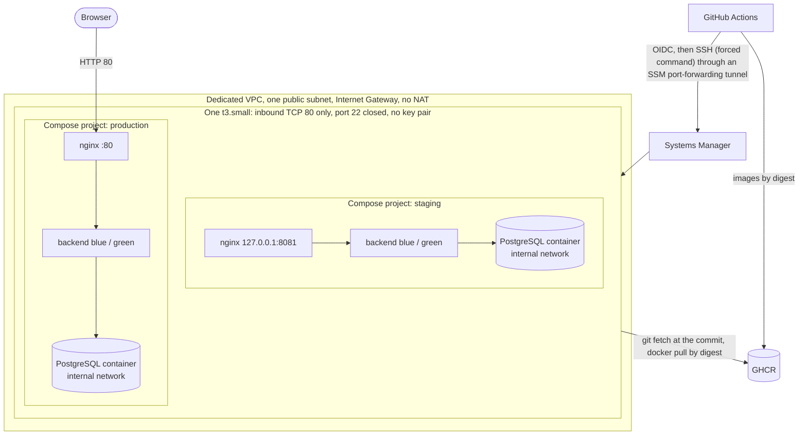
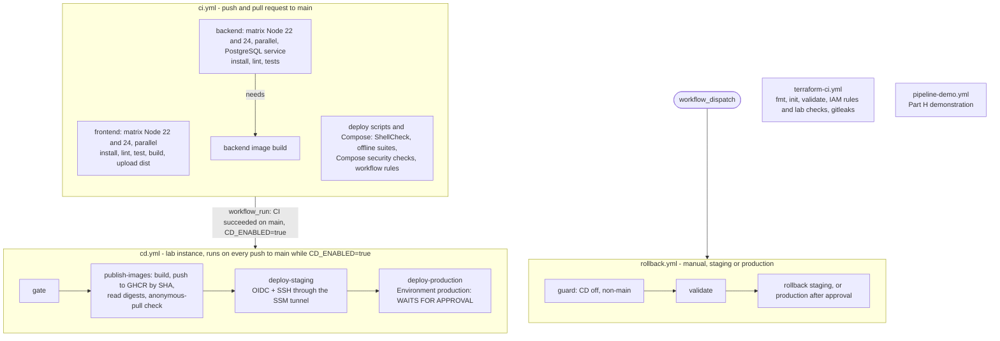
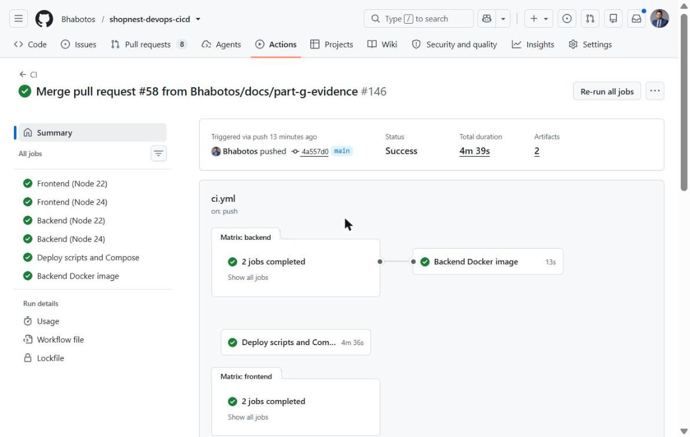
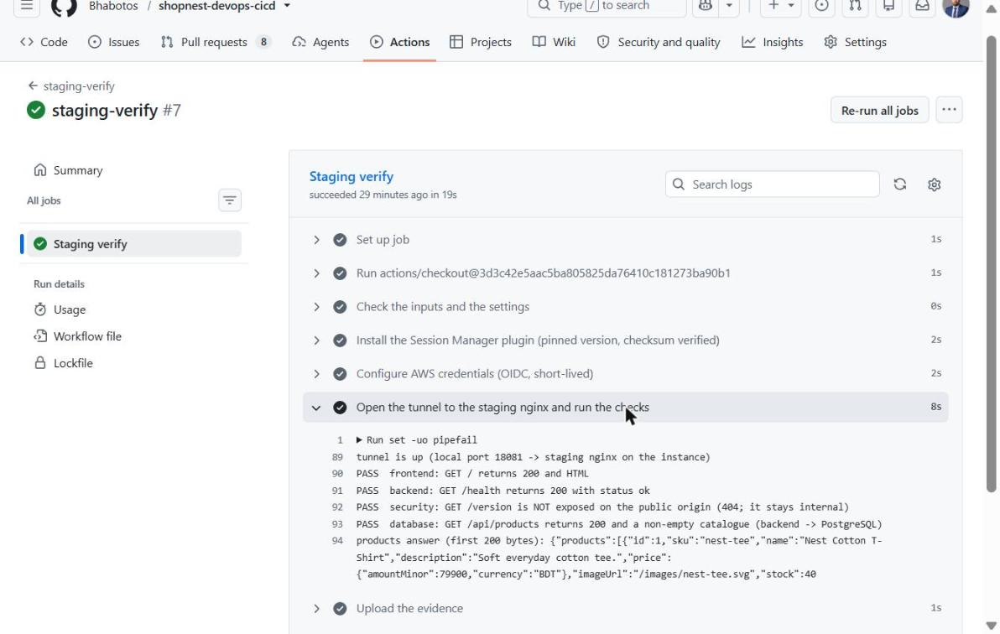
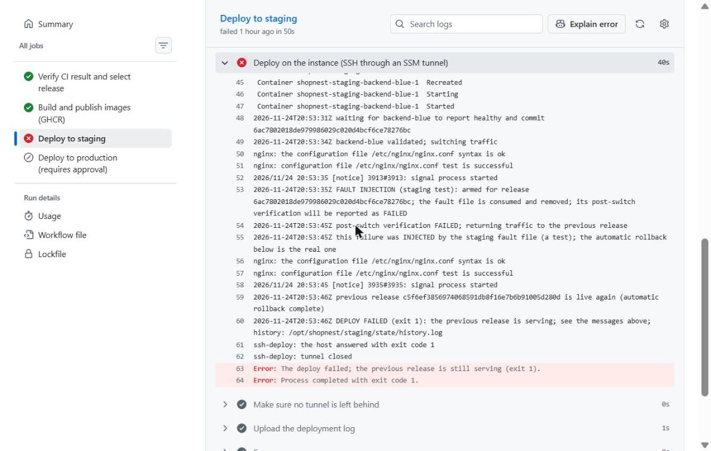

# ShopNest: automated CI/CD for a three-tier application

ShopNest is a small e-commerce product: a React frontend, a Node.js REST API and a PostgreSQL database. This repository replaces ShopNest's
manual, SSH-and-restart deployments with an automated, secure pipeline built on GitHub Actions, and records what has been proven and what has not.

> **Honest status (updated 2026-11-25).** The application, the CI pipeline and the local Docker environment are built and verified, and **the pipeline has deployed STAGING for real** on one EC2
> instance: images built by GitHub Actions and published to GHCR by digest, SSH through an AWS Systems Manager tunnel (no inbound port 22), blue/green with health-gated switching and automatic rollback.
> Real, kept runs show **six deploy or rollback operations under request loops (5237 requests, 0 failed)**, an **automatic rollback** and a **manual rollback** (see [Evidence](#evidence-and-workflow-links)).
> **Production has NOT been deployed:** its job waits for the production reviewer, who has not approved it, so the **live URL is pending** ([Live URL](#live-url)). Two caveats are stated where they matter:
> the automatic rollback was triggered by a failure *injected into the post-switch verification* (the new release was actually healthy), and the zero-downtime numbers come from a sparse request loop (about 2 requests per second).
> **Part H:** three deliberate failures with kept runs exist, but the Copilot troubleshooting for them is unavailable; the Copilot exercise is prepared in [`docs/COPILOT_EXERCISE.md`](docs/COPILOT_EXERCISE.md) and has **not** been done yet.
> **Screenshots:** staging screenshots for Parts E, F and G (CD pipeline, staging deploy job, staging health checks, one request-loop summary, the injected-failure automatic rollback) are in [Assignment Evidence](#assignment-evidence); **AWS console, manual rollback and restore, production and live-application screenshots are pending** ([`docs/SCREENSHOT_CHECKLIST.md`](docs/SCREENSHOT_CHECKLIST.md)); none is claimed. Every claim below says whether it was proven by a real run, tested offline, or is pending. The per-requirement record is
> [`docs/REQUIREMENTS_CHECKLIST.md`](docs/REQUIREMENTS_CHECKLIST.md); the verified list of run links is [`docs/EVIDENCE_INDEX.md`](docs/EVIDENCE_INDEX.md).

## Contents
1. [Part A: CI/CD concepts for ShopNest management](#part-a-cicd-concepts-for-shopnest-management)
2. [Technology stack](#technology-stack)
3. [Three-tier architecture](#three-tier-architecture)
4. [Repository structure](#repository-structure)
5. [Local development](#local-development)
6. [Testing and validation](#testing-and-validation)
7. [GitHub Actions workflows](#github-actions-workflows)
8. [Secrets and variables](#secrets-and-variables)
9. [Terraform infrastructure](#terraform-infrastructure)
10. [CD architecture and current limitations](#cd-architecture-and-current-limitations)
11. [Zero-downtime strategy and trade-offs](#zero-downtime-strategy-and-trade-offs)
12. [Rollback strategy](#rollback-strategy)
13. [Security practices](#security-practices)
14. [Deployment prerequisites](#deployment-prerequisites)
15. [Troubleshooting](#troubleshooting)
16. [Assignment rubric mapping](#assignment-rubric-mapping)
17. [Evidence and workflow links](#evidence-and-workflow-links)
18. [Assignment Evidence](#assignment-evidence)
19. [Live URL](#live-url)

## Part A: CI/CD concepts for ShopNest management

**Continuous Integration (CI)** means every change is merged into the shared branch often and is built and tested automatically each time, so a broken
change is found in minutes, before anyone depends on it.
**Continuous Delivery** extends CI so that every change that passes is automatically packaged and made ready to release, but a person decides when it goes live.
**Continuous Deployment** removes that decision: every change that passes all checks is released to users automatically.
The difference is the last step: Delivery keeps a human approval before production; Deployment has none.

### How the pipeline addresses the four incidents

| Incident | Cause | Pipeline feature | State today |
|---|---|---|---|
| 1. A broken build reached production because nobody ran the tests | deployment was manual and untested | CI runs lint, tests and build for frontend and backend on every pull request and push to `main`; branch protection requires five CI checks before a merge; CD starts only after CI succeeds on the exact commit, and a failed database migration stops the deployment | CI **tested on GitHub Actions**; branch protection applied; the CD gate and the migration step **ran for real on staging** (CD run [45469834249](https://github.com/Bhabotos/shopnest-devops-cicd/actions/runs/45469834249): migrations applied before traffic moved); a *failing* migration stopping a deploy is tested offline only |
| 2. About 10 minutes of downtime on every deployment | the old release was stopped before the new one started | blue/green: the new release starts beside the old one, is health-checked, and only then receives traffic | **demonstrated on staging on AWS**: 6 deploy or rollback operations under request loops, 5237 requests, 0 failed ([evidence](#zero-downtime-strategy-and-trade-offs)); the sampling limit is stated there |
| 3. Two hours to restore the previous version, because nobody knew the last good one | no release record | every release is tagged with its commit SHA, the image is recorded by digest, a release history records good and failed releases, and automatic and manual rollback restore a known good release | **demonstrated on staging**: automatic rollback (CD run [45485258931](https://github.com/Bhabotos/shopnest-devops-cicd/actions/runs/45485258931), failure injected into the verification) and manual rollback to `3c53ba7` (run [45485651117](https://github.com/Bhabotos/shopnest-devops-cicd/actions/runs/45485651117)) |
| 4. Passwords and keys committed to the repository | secrets in source control | secret scanning (gitleaks) in a pre-commit hook and before every push, GitHub push protection, no credential in any file, only one GitHub secret per Environment (the deploy SSH key, masked by GitHub and never printed), short-lived OIDC credentials instead of stored AWS keys, database passwords generated on the instance (mode 600, never printed) | scanning **tested**, and an all-history scan is clean (151 commits, no leak); OIDC **verified by real runs** (staging role assumption; the production one is waiting for the reviewer) |

### Approach chosen for ShopNest: Continuous Delivery to production

Planned design (not yet running): a merge to `main` runs CI; after CI passes, the release is deployed automatically to **staging**, and **production
requires a manual reviewer approval** (a GitHub Environment protection rule). This is Continuous Delivery for production, chosen because ShopNest has just had a
bad release: an automated safety net (tests, health checks, rollback) is valuable, but a person should still own the moment production changes.
Staging is continuously deployed. **Production deployment and its approval gate are not implemented**: the CD workflow deploys staging only and says so in its run summary.

## Technology stack

| Tier / concern | Technology |
|---|---|
| Presentation | React and Vite, served by Nginx in a container |
| Application | Node.js and Express 5, Zod validation, `pg`, the AWS SDK (Secrets Manager client) |
| Data | PostgreSQL 16 in a Docker container on an internal network (locally, and in the lab instance's two environments); the earlier AWS design used a private Amazon RDS instance |
| Runtime | Node.js 22 and 24 (tested in CI); local development on Node.js 24 |
| Tests | Vitest, Supertest, React Testing Library; offline shell suites with fake Docker and fake AWS |
| Containers | Docker and Docker Compose; third-party images pinned by version and digest; the application images are published to **GHCR** tagged with the commit SHA and deployed by digest |
| Pipelines | GitHub Actions (`ci.yml`, `cd.yml`, `rollback.yml`, `terraform-ci.yml`, and the Part H demonstration workflow `pipeline-demo.yml`) |
| Infrastructure | Terraform (AWS, region `ap-south-1`), `infra/lab/`: a dedicated VPC, one public subnet, an Internet Gateway, one `t3.small` with a public address, HTTP 80 inbound only; no NAT Gateway, load balancer, RDS or ECR. The earlier, larger design in `infra/terraform/` is kept for reference. Written, **not applied** |
| Deployment mechanism | SSH through an AWS Systems Manager port-forwarding tunnel (no inbound port 22): each Environment has its own forced-command key that can start only two root-owned wrappers on the instance; GitHub Actions authenticates to AWS through OIDC and the images are pulled from GHCR by digest; **ran for real on staging** (see [Evidence](#evidence-and-workflow-links)); production not deployed |
| Quality and security | ESLint, ShellCheck, actionlint, gitleaks, GitHub secret scanning and push protection |

## Three-tier architecture


- **Presentation:** the React single-page app is built by Vite and served as static files by Nginx. Nginx also proxies `/api/` to the backend.
- **Application:** the Express API exposes `GET /health`, `GET /version` (release version and commit SHA), `GET /api/products`, `GET /api/products/:id`,
  `POST /api/orders` and `GET /api/orders/:id`. It validates input, logs structured JSON and shuts down gracefully.
- **Data:** PostgreSQL holds products and orders. In every Docker environment the database sits on an internal network with no published port. Two database
  roles are used: `shopnest_owner` (migrations) and `shopnest_app` (the API, least-privilege per-table grants).

The diagram shows the application as run locally and in the laptop rehearsal (one host, Docker-hosted PostgreSQL).

### On AWS: the lab instance (staging deployed; production waiting for approval)



Both environments run on the one instance as separate Compose projects; **only production is public** (port 80), staging listens on the loopback address and is reached through Session Manager. The databases have no published port and sit on an
internal Docker network. Details, limits and the proof status: [`docs/LAB_DEPLOYMENT.md`](docs/LAB_DEPLOYMENT.md). GitHub renders these diagrams from the Mermaid source; rendering on GitHub has **not** been checked.

## Repository structure

| Path | Contents |
|---|---|
| `frontend/` | React + Vite app, Nginx config, Dockerfile, tests |
| `backend/` | Express API, SQL migrations (`migrations/`), migrate, seed, bootstrap and connectivity scripts, the pinned RDS CA bundle (`certs/`), Dockerfile, tests |
| `deploy/` | Compose files (dev, test, AWS production, and a laptop-rehearsal database file), Nginx config, blue/green deploy and rollback scripts, `ci/` (CI-side helpers), `host/` (metadata-service guard and systemd units), `codebuild/` (build specifications), offline test suites, per-environment non-secret settings (`env/`) |
| `infra/terraform/` | Terraform for AWS, plus its architecture, security review, remediation log and integration-gap report |
| `.github/workflows/` | `ci.yml`, `cd.yml`, `rollback.yml`, `terraform-ci.yml`, `pipeline-demo.yml` (Part H demonstration) |
| `.githooks/` | versioned pre-commit hook that runs gitleaks |
| `docs/` | AWS staging integration, architecture, GitHub setup, OIDC design, requirements checklist, audit, roadmap, Copilot and run evidence, and the Part H failure write-up (`docs/failures/`) |
| `assignment/` | the assignment brief (kept out of version control) |

## Local development

Prerequisites: Node.js 24 (the code accepts `^22.22.2 || ^24.15.0`), Docker with Compose v2, Git, and [gitleaks](https://github.com/gitleaks/gitleaks) for the commit hook.

1. Enable the secret-scanning hook once per clone: `git config core.hooksPath .githooks` (details: [`docs/GITHUB_SETUP.md`](docs/GITHUB_SETUP.md)).
2. Full local stack (database, migrations, demo data, backend, frontend):
   ```bash
   cp deploy/.env.example deploy/.env      # then edit: set your own local passwords (letters and digits only)
   docker compose -f deploy/docker-compose.dev.yml up --build
   ```
   The frontend is on `http://127.0.0.1:8080` and the API on `http://127.0.0.1:3100` (loopback only). The database has no published port.
   Never commit `deploy/.env`; it is git-ignored.
3. Frontend alone: `cd frontend && npm ci && npm run dev` (Vite proxies `/api` to `127.0.0.1:3100`).
4. Backend alone (against a PostgreSQL you run yourself): `cd backend && npm ci`, copy `backend/.env.example` to `backend/.env` and fill it in. **The backend does not read `.env` by itself** (it has no dotenv dependency), so
   load it explicitly with Node's flag, for example `node --env-file=.env scripts/migrate.js`, `NODE_ENV=development node --env-file=.env scripts/seed.js` and `node --env-file=.env src/server.js`, or export the variables in your shell.
   Migrations and the seed must connect as the owner role (`shopnest_owner`); the running API connects as `shopnest_app`, so use a different `DATABASE_URL` for each.

Configuration is read from environment variables (`PORT`, `HOST`, `DATABASE_URL`, `APP_VERSION`, `GIT_SHA`, `LOG_LEVEL`, pool and timeout settings); see
[`backend/.env.example`](backend/.env.example). Seeding is refused unless `NODE_ENV` is `development` or `test` (or `production` with an explicit flag).

**Two database modes.** Locally the backend uses `DATABASE_URL`. On AWS it uses **no** `DATABASE_URL`: it reads its user and password from AWS Secrets Manager and connects to RDS over TLS, verifying the
server certificate against the pinned bundle in `backend/certs/`. The two modes are mutually exclusive and the backend refuses to start if both are set. The laptop blue/green rehearsal
(`deploy/docker-compose.local-db.yml`) is for local use only and is refused for staging and production.

## Testing and validation

| What | Command | Notes |
|---|---|---|
| Frontend lint, test, build | `cd frontend && npm ci && npm run lint && npm test && npm run build` | no database needed |
| Backend lint | `cd backend && npm ci && npm run lint` | |
| Backend tests (unit and API) | `cd backend && npm test` | database integration tests are skipped when `TEST_DATABASE_URL` is unset |
| Backend integration tests | start `deploy/docker-compose.test.yml` (see the header of that file), then `TEST_DATABASE_URL=... npm test --prefix backend` | disposable in-memory database; the database name must end in `_test` |
| Blue/green decision logic (offline) | `bash deploy/tests/bluegreen-logic.test.sh` | fake Docker and fake AWS; no containers; takes several minutes |
| Metadata-guard rules (offline) | `bash deploy/tests/imds-guard.test.sh` | fake `iptables` and Docker; no root |
| CI helpers (offline) | `bash deploy/tests/ci-helpers.test.sh` | bundle, image push, migrator and Systems Manager runner, against fake AWS |
| Workflow security rules (static) | `bash deploy/tests/workflows.test.sh` | reads the workflow files; needs Python with PyYAML |
| Terraform IAM and gating (static; the earlier design) | `bash deploy/tests/terraform-iam.test.sh` | reads the `.tf` files of `infra/terraform`; no Terraform or AWS |
| Lab deploy and rollback decisions (offline) | `bash deploy/tests/lab-mode.test.sh` | fake Docker; no containers; digests, generated passwords, loopback staging, refused releases, rollback re-pull |
| Lab Terraform architecture (static) | `bash deploy/tests/lab.test.sh` | reads `infra/lab`; no Terraform or AWS |
| Terraform format and validity | `cd infra/terraform && terraform fmt -check -recursive && terraform validate` | needs an initialised working directory; contacts nothing |
| Local stack verification | `bash deploy/scripts/verify-stack.sh` | needs Docker; creates and removes its own throwaway Compose project |
| Backend image check | `bash deploy/scripts/verify-backend-build.sh` | needs Docker |
| Local blue/green and rollback rehearsal | `bash deploy/scripts/demo-bluegreen-local.sh --help` | needs a local Docker engine; run only in the throwaway project it creates; **not re-run since the AWS-mode changes** |

**Results (2026-11-21, local and offline). The same suites also ran, and passed, in the GitHub Actions job "Deploy scripts and Compose" and in Terraform CI on pull requests #24, #25 and #26; the counts below are from the local runs:**

| Suite | Result |
|---|---|
| Backend (Vitest) | 160 passed, 0 failed, 11 skipped (the PostgreSQL integration tests, which need a live database); ESLint clean |
| Blue/green offline suite | 305 passed, 0 failed |
| Metadata-guard suite | 135 passed, 0 failed |
| CI-helper suite | 146 passed, 0 failed |
| Workflow static checks | 68 passed, 0 failed |
| Terraform static IAM checks | 97 passed, 0 failed |
| `terraform fmt` and `validate` | pass |
| ShellCheck (every shell file under `deploy/`) and actionlint (every workflow) | clean |

These prove decisions and rules against fakes. They do **not** prove behaviour on real containers, real iptables, or AWS. The last CI results from GitHub Actions are in [Evidence](#evidence-and-workflow-links);
earlier captured outputs from real local runs are in [`docs/evidence/phase2/`](docs/evidence/phase2/). Some tests were written with AI assistance; the owner is writing the additional tests listed in
[`docs/PHASE2_TEST_SPECS.md`](docs/PHASE2_TEST_SPECS.md).

## GitHub Actions workflows



| Workflow | Trigger | State |
|---|---|---|
| `ci.yml` | pull request and push to `main` | **runs and passes on GitHub** (on the pull requests #22 to #26 and on the pushes to `main`). Jobs: Frontend (Node 22 and 24: install, lint, test, build, upload `dist`), Backend (Node 22 and 24: install, lint, tests against a throwaway PostgreSQL service container, fail if any test was skipped), Backend Docker image (needs Backend), Deploy scripts and Compose (shell syntax, ShellCheck, the offline blue/green, metadata-guard and CI-helper suites, AWS-mode and rehearsal-mode Compose security assertions, the deployment-workflow rules). The matrix jobs run in parallel. The updated "Deploy scripts and Compose" job ran and passed on pull requests #24 to #26 (its first run on #26 failed on one test assertion that depended on a Git file mode; the assertion was corrected and the failed run is kept in the Actions history) |
| `cd.yml` | `workflow_run` after CI on `main` | **ran for real on staging** (runs [45469834249](https://github.com/Bhabotos/shopnest-devops-cicd/actions/runs/45469834249), [45473412551](https://github.com/Bhabotos/shopnest-devops-cicd/actions/runs/45473412551), [45477964033](https://github.com/Bhabotos/shopnest-devops-cicd/actions/runs/45477964033), [45479105861](https://github.com/Bhabotos/shopnest-devops-cicd/actions/runs/45479105861), [45485258931](https://github.com/Bhabotos/shopnest-devops-cicd/actions/runs/45485258931), [45486448054](https://github.com/Bhabotos/shopnest-devops-cicd/actions/runs/45486448054)). Jobs: `gate` (CI succeeded for the exact commit, still the tip of `main`, `CD_ENABLED` is `true`), `publish-images` (build backend and frontend, push to GHCR tagged with the commit SHA, read back the digests, anonymous-pull check), `deploy-staging` (Environment `staging`, SSH through the SSM tunnel, blue/green, automatic rollback), `deploy-production` (Environment `production`: **held for the reviewer and never approved**). Concurrency is per Environment (a waiting production job must not block staging). A run can show `cancelled` when a newer run's pending production job superseded its own, even though its staging deploy succeeded |
| `rollback.yml` | manual dispatch | **ran for real on staging**: run [45485651117](https://github.com/Bhabotos/shopnest-devops-cicd/actions/runs/45485651117) rolled staging back to the first deployed commit `3c53ba7` (`ROLLBACK SUCCEEDED`). It **fails closed**: a request while `CD_ENABLED` is not `true`, from a ref other than `main`, or for an unknown environment is refused; the target must be an ancestor of `main` and recorded as deployed on the host; the job is bound to the chosen Environment, so a production rollback waits for the reviewer |
| `terraform-ci.yml` | Terraform-related pushes and pull requests | runs static checks only, no AWS access (format, init without a backend, validate, secret scan) for `infra/terraform` and, in a separate job, for `infra/lab` plus the lab architecture checks |
| `ssh-preflight.yml` | manual dispatch | proves OIDC, the SSM tunnel, the pinned host key and the forced command for an Environment and **deploys nothing** (staging run [45459661738](https://github.com/Bhabotos/shopnest-devops-cicd/actions/runs/45459661738) succeeded); `simulate: wrong-host-key` is the safe deliberate failure for the Part H exercise |
| `staging-verify.yml` | manual dispatch | checks staging from outside (frontend, `/health`, `/version` hidden, database-backed `/api/products`) or runs the Part F request loop, through an SSM port-forward; never touches production |
| `pipeline-demo.yml` | push to `demo/**` and manual dispatch | the Part H demonstration workflow (generated with GitHub Copilot, per the owner's records in `docs/copilot/`); see [Evidence](#evidence-and-workflow-links) |

**Required checks** on `main` (branch protection, verified by reading the settings on 2026-11-21): Frontend (Node 22), Frontend (Node 24), Backend (Node 22),
Backend (Node 24), Backend Docker image (each bound to the GitHub Actions app); a pull request is required (0 approvals), branches must be up to date, the rules apply to administrators, and force pushes and branch deletion are disabled
(**verified live configuration**, written read-back: [`docs/evidence/BRANCH_PROTECTION_READBACK_2026-11-21.md`](docs/evidence/BRANCH_PROTECTION_READBACK_2026-11-21.md), not a raw API response; the settings screenshots in [`docs/screenshots/part-h/`](docs/screenshots/part-h/) are **partial**; the required-checks half of the page is shown in [`docs/screenshots/branch-protection.png`](docs/screenshots/branch-protection.png)).
"Deploy scripts and Compose" and the Terraform checks are **not** required: the deployment validation is not yet mature enough to be a mandatory merge gate, so only the five application CI checks are mandatory.
Conversation resolution is intentionally disabled (accepted configuration for a single-maintainer assignment project).
**Project convention:** pull requests are merged with a normal merge commit. Squash and rebase merging remain **enabled** in GitHub, so this is a working convention, not an enforced restriction.
A failing required check was demonstrated on [PR #28](https://github.com/Bhabotos/shopnest-devops-cicd/pull/28): a deliberate failing test made both Backend checks fail and the Docker-image check skip, and GitHub reported the merge as blocked
(observed through the GitHub API). **There is no screenshot of a live blocked-merge banner** (the checks are green now and it cannot be recreated); [`pr28-blocked-check.png`](docs/screenshots/part-b/pr28-blocked-check.png) shows the check results on the failing commit (two Backend checks failing, Docker image skipped), not the merge box. PR #28 is an intentionally open failure demonstration and **must not be merged**.

All workflows declare explicit `permissions:` and every `uses:` reference is pinned to a commit SHA; a static check enforces this for the deployment workflows.

## Secrets and variables

**The one secret in the deployment path is each Environment's `DEPLOY_SSH_KEY`** (a different ed25519 key per Environment, bound to its Environment on the host). Images are pushed to GHCR with the run's own short-lived `GITHUB_TOKEN`, AWS access comes from GitHub OIDC (short-lived credentials), and the database passwords are **generated on the instance**
at the first deploy (mode 600, never printed, never stored elsewhere). Nothing below holds a value in the repository.
GitHub Environments `staging` and `production` exist (main-only; `production` requires the reviewer `Bhabotos`, administrator bypass off; recorded 2026-11-23 with 0 variables and 0 secrets). Creating the variables below is a GitHub
settings change that needs separate approval; CD stays disabled while `CD_ENABLED` is unset.

| Name | Kind | Purpose | Status |
|---|---|---|---|
| `CD_ENABLED` | repository variable | master switch: unless exactly `true`, CD is skipped and a rollback request is refused | not set |
| `AWS_ROLE_ARN` | variable of each Environment (`staging`, `production`) | the OIDC deploy role of that Environment (it can only open an SSM port-forwarding session to the instance) | set on both (names verified 2026-11-24) |
| `AWS_REGION` | variable of each Environment | the AWS region (`ap-south-1`) | set on both |
| `LAB_INSTANCE_ID` | variable of each Environment | the lab instance the tunnel targets | set on both |
| `SSH_HOST_KEY` | variable of each Environment | the instance's PUBLIC SSH host key, pinned so strict host-key checking stays on | set on both |
| `DEPLOY_SSH_KEY` | **secret** of each Environment | that Environment's private deploy key (staging and production differ) | set on both (name verified; value never read) |
| `GITHUB_TOKEN` | automatic, per run (not a stored secret) | pushes the images to GHCR (`packages: write` in one job only) | in the workflow design |

Terraform-side values (never committed; both files are git-ignored): `allowed_account_ids` in `infra/lab/lab.tfvars`, and the state bucket name in `infra/lab/backend.hcl`.
The earlier SSH names (`SSH_PRIVATE_KEY`, `SSH_KNOWN_HOSTS`, `EC2_HOST`, `EC2_USER`, `SSH_SG_ID`) and the earlier AWS-design names (`ECR_REPOSITORY`, `ARTIFACT_BUCKET`, `MIGRATOR_PROJECT`, `STAGING_INSTANCE_ID`) are **obsolete**; a CI check fails if any reappears in `cd.yml` or `rollback.yml`.
Separate configuration for staging and production exists as non-secret files in [`deploy/env/`](deploy/env/) and as separate GitHub Environments, each with its own variables and its own AWS role.

## Terraform infrastructure

Status: **`infra/lab/` is written, statically validated (`terraform fmt`, `terraform validate`, 87 static architecture checks in CI) and applied by the owner: the instance, its security group (TCP 80 only) and the two OIDC deploy roles exist (read-only checks on 2026-11-24; the apply record is in [`docs/PROJECT_HISTORY.md`](docs/PROJECT_HISTORY.md)).**
Passing validation does not mean AWS will accept the configuration. Region `ap-south-1`; Terraform CLI profile name `devops` locally; no root credentials and no access keys. Details: [`infra/lab/README.md`](infra/lab/README.md).

What `infra/lab/` describes:
- a dedicated VPC, **one public subnet**, an Internet Gateway and a route table (no NAT Gateway);
- **one `t3.small`** with a public IPv4 address (an Elastic IP by default), a security group that admits **TCP 80 only** (port 22 closed: no inbound SSH, no HTTPS, no database port), IMDSv2, an encrypted root volume and no key pair;
- a new instance role that can only use Systems Manager; Docker, Compose and git installed at first boot;
- **optional, off by default (`enable_cicd = false`):** one GitHub OIDC deploy role per Environment and four fixed Systems Manager command documents;
- remote state in an **existing** S3 bucket (key `terraform/shopnest/terraform.tfstate`, encryption on, S3 lock file); the bucket name is supplied from an untracked file.

Not created: NAT Gateway, load balancer, RDS, ECR, a state bucket, a key pair, any access key. The earlier design in [`infra/terraform/`](infra/terraform/README.md) (RDS, ECR, ALB, NAT, CodeBuild) is **unchanged and unused by the deployment workflows**; its saved plan
files are stale and must never be applied. Approximate cost of the lab: about $21 to $26 a month (an estimate, not a quote; see `infra/lab/README.md`).

## CD architecture and current limitations

**Flow (`cd.yml`, ran for real on staging):** CI succeeds on a push to `main` -> `gate` (exact commit, still the tip of `main`, `CD_ENABLED=true`) -> `publish-images` (backend and frontend built for the commit, pushed to **GHCR** tagged with the SHA, **digests** read back, anonymous pull checked)
-> `deploy-staging` -> `deploy-production` (held for the reviewer). The deploy is **SSH through a Systems Manager port-forwarding tunnel** (no inbound port 22): the Environment's own key (one per Environment, forced command, pinned host key with strict checking) can start only two
root-owned wrappers on the instance, which verify that the commit is part of `main`, fetch it, pull both images by digest (the revision label must equal the commit), apply migrations and run the blue/green deploy. The client reports success only when the host confirms that this commit went live from these digests. Diagram and details: [`docs/LAB_DEPLOYMENT.md`](docs/LAB_DEPLOYMENT.md).

**What actually ran:** the first staging deployment ([https://github.com/Bhabotos/shopnest-devops-cicd/actions/runs/45469834249](https://github.com/Bhabotos/shopnest-devops-cicd/actions/runs/45469834249): migrations applied, catalogue seeded, `backend-blue` validated, `DEPLOY SUCCEEDED`, `CONFIRMED` with both digests), three further blue/green deployments (2, 3 and 4), a fault-injected deploy that rolled back automatically, a manual rollback and a restore. Host logs are kept under [`docs/evidence/`](docs/evidence/).

**Limits, stated plainly:**
- **Production has not been deployed.** Its job waits for the `production` reviewer and has never been approved. The staging deployments prove the mechanism; they do not prove a production release.
- One `t3.small` hosts both environments as separate Compose projects (separate ports, networks, volumes and database containers); one host is a single point of failure and there is no database backup (demo data). Staging listens on loopback only and is reached through Session Manager.
- While `CD_ENABLED=true`, **every push to `main` deploys to staging**. Each run also queues a production job that waits for the reviewer.
- **GitHub concurrency:** a job waiting for a reviewer keeps its concurrency group, which blocked every later staging deploy on the first real run; groups are now per Environment ([`cd.yml`](.github/workflows/cd.yml)), and the host's own lock still serializes the instance.
- **Public logs** show the instance id and, once, the role ARN with the AWS account id (credentials are masked); none of this is a credential.
- The installed host wrapper version was not re-checked after the review fixes; update it with `setup-deploy-host.sh` before any production deployment.
- **"Over SSH" (Part E):** the tunnel carries real SSH, so the wording is met literally. The live-URL question (Part D forbids a server address in the repository, the assignment asks for a live URL) is the owner's decision and is still open.

## Zero-downtime strategy and trade-offs

**Strategy: blue/green on the host.** Two backend containers (blue, green) exist; Nginx sends `/api` and `/health` to the active one. A release starts on the idle colour and must report `/health` OK and `/version` equal to its commit SHA; only then does Nginx switch (a tested, graceful reload),
and the old colour keeps running for 10 s so in-flight requests finish. If validation fails, traffic never moves. `/version` is internal by design (the public origin answers 404), so the running commit is read from the host log. Scripts:
[`deploy/scripts/bluegreen-deploy.sh`](deploy/scripts/bluegreen-deploy.sh), [`deploy/scripts/rollback.sh`](deploy/scripts/rollback.sh), [`deploy/nginx/nginx.conf`](deploy/nginx/nginx.conf).

**Measured on staging (real instance, real deployments).** `deploy/scripts/request-loop.sh` sent requests to `/health` through a Systems Manager port-forward while staging deployments ran:

| Request loop | Deployments covered | Requests | Failed | Timeouts | Latency p50 / p95 / p99 |
|---|---|---|---|---|---|
| [https://github.com/Bhabotos/shopnest-devops-cicd/actions/runs/45473006606](https://github.com/Bhabotos/shopnest-devops-cicd/actions/runs/45473006606) | deploy 2 (`blue` to `green`) | 1117 | **0** | 0 | 240 / 242 / 244 ms |
| [https://github.com/Bhabotos/shopnest-devops-cicd/actions/runs/45477290060](https://github.com/Bhabotos/shopnest-devops-cicd/actions/runs/45477290060) | deploys 3 and 4 | 1850 | **0** | 0 | 239 / 243 / 246 ms |
| [https://github.com/Bhabotos/shopnest-devops-cicd/actions/runs/45484404230](https://github.com/Bhabotos/shopnest-devops-cicd/actions/runs/45484404230) | fault-injected deploy with automatic rollback, manual rollback, restore deploy | 2270 | **0** | 0 | 205 / 206 / 211 ms |

That is **six real deploy or rollback operations observed with no failed request** (deploys 2, 3 and 4; the fault-injected deploy with its automatic rollback; the manual rollback; the restore) (summaries, logs and host timelines: [`docs/evidence/zero-downtime/`](docs/evidence/zero-downtime/) and [`docs/evidence/rollback/`](docs/evidence/rollback/)).
**What this does not prove:** the loop sends only about 2 requests per second (the tunnel round trip is about 0.2 s), so a failure shorter than roughly half a second could fall between two requests; it requested `/health` only (the frontend and API were checked separately);
and the latencies include the tunnel. It is strong measured evidence for these deployments, not a proof of zero downtime in general. The local Docker rehearsal ([`docs/evidence/bluegreen-local/`](docs/evidence/bluegreen-local/): 238 of 238, 107 of 107 and 161 of 161 responses)
predates the AWS-mode changes and is kept for reference. A fault that appears only *after* the switch can cost failed requests before the rollback completes (79 of 171 in one local rehearsal): such a failure is recovered, not invisible.

Trade-offs: two backends run during a deploy (more memory); the database schema must stay compatible with both the old and new release (migrations are additive and a rollback never reverses them); one host is a single point of failure.

## Rollback strategy

- **Automatic (demonstrated on staging):** if the post-switch verification fails, traffic is switched back to the previous release, which is verified again; the deploy exits 1 ("failed, previous release serving") and the production job never runs. In CD run [https://github.com/Bhabotos/shopnest-devops-cicd/actions/runs/45485258931](https://github.com/Bhabotos/shopnest-devops-cicd/actions/runs/45485258931) the host log shows
  `FAULT INJECTION ... armed`, `post-switch verification FAILED; returning traffic to the previous release`, `previous release c5f6ef3... is live again (automatic rollback complete)` and `DEPLOY FAILED (exit 1): the previous release is serving`.
  **Caveat:** the failure was injected into the *verification* by a one-shot, staging-only, root-owned fault file armed on the host (see [`docs/LAB_DEPLOYMENT.md`](docs/LAB_DEPLOYMENT.md#part-g-demonstrations-staging-only); production never reads it, a rollback never arms it, the first deploy is never sabotaged). The new release's containers were actually healthy,
  so this shows the real rollback mechanism, not a real broken backend. A second fault, which genuinely freezes the new backend container so that its health checks really fail (the release is rejected before any traffic moves), is implemented and tested offline ([`docs/PART_G_REAL_FAULT_DESIGN.md`](docs/PART_G_REAL_FAULT_DESIGN.md)); it has **not yet been run on the instance**.
- **Manual (demonstrated on staging):** `rollback.yml` (staging, or production after the reviewer's approval) runs `deploy/scripts/rollback.sh` from the tip of `main`. It refuses a release that is not recorded as deployed, re-pulls the recorded image digests if the host lost the images (tested offline; **not exercised on the instance**, the images were still there),
  and moves traffic only after the release passes the same validation as a deploy. Run [https://github.com/Bhabotos/shopnest-devops-cicd/actions/runs/45485651117](https://github.com/Bhabotos/shopnest-devops-cicd/actions/runs/45485651117) rolled staging back to `3c53ba7` (`ROLLBACK SUCCEEDED`); run [https://github.com/Bhabotos/shopnest-devops-cicd/actions/runs/45486448054](https://github.com/Bhabotos/shopnest-devops-cicd/actions/runs/45486448054) then restored the newest release.
- **Health checks:** the backend `/health` runs `SELECT 1` against PostgreSQL; the deploy requires it (and the commit) before the switch and again after it, through nginx and the published port; Docker health checks cover the database.
- **Exit codes:** `0` success; `1` failed with the previous release serving (or restored): **observed on staging**; `2` bad arguments; `3` the deploy or rollback **and** the recovery failed, which needs an operator now (offline suites only; **no real code 3 has been observed**); `4` the result could not be confirmed (treat as failed).
- **Database:** a rollback **never runs migrations** and **never reverses the schema**. Recovery from a bad migration is a fix-forward migration or restoring the database volume (the lab instance keeps no backup: demo data).

## Security practices

- No credential, key or server address in the repository or its history; gitleaks runs in a versioned pre-commit hook (which must be enabled per clone) and is run manually before every push as a project rule. Evidence: [`docs/evidence/secret-scan/`](docs/evidence/secret-scan/).
  The scanner's IPv4 rule has two deliberate, narrow exceptions beyond loopback (approved 2026-11-21): the project's own private container network and the documented EC2 metadata address, neither of which is a server address.
  A final all-history scan is required before submission.
- GitHub secret scanning and push protection enabled; branch protection with required checks; no direct pushes to `main`; work goes through feature branches and pull requests.
- No AWS root credentials, no permanent AWS access keys and only one GitHub secret per Environment (`DEPLOY_SSH_KEY`) in the deployment path: GHCR pushes use the run's own token, AWS access is GitHub OIDC with short-lived credentials, trust pinned to an exact Environment subject. The roles and the instance exist (read-only checks, 2026-11-24); **staging deployments have run through them; production has not been deployed**.
- Least-privilege identities by design: the instance role can only use Systems Manager; each Environment's deploy role can send only that Environment's two fixed documents to the one instance and cannot read a secret or change infrastructure. Enforced by static checks on the Terraform source (`deploy/tests/lab.test.sh`); **not tested against AWS**.
- The deployment workflows are SSM-only; a static check fails if SSH, a stored credential, an unpinned action, or an expression inside a script reappears.
- **Metadata service:** in the lab the instance's metadata hop limit is 1, so no container can reach the instance role at all (the containers need no AWS credential: images and code are public). The earlier design's host firewall guard is not used by the lab. **Not verified on a real instance.**
  A compromised backend would still hold the instance role (residual risk, documented). This is **not verified on a real instance**; see [section 7 of the AWS document](docs/AWS_STAGING_INTEGRATION.md#7-metadata-service-imds-isolation).
- The database has no published port in the development Compose file, in the lab Compose configuration (checked in CI with `docker compose config`) or in the Terraform design, and the lab's security group admits only port 80. The one exception is the disposable test database in `deploy/docker-compose.test.yml`, which is bound to loopback only (`127.0.0.1`). Application containers run as non-root. Third-party images are pinned by version and digest; the application images are tagged per release and deployed by digest.
- The lab uses a PostgreSQL container, so there is no RDS TLS to verify; the database is reachable only on the internal Docker network. The earlier design's RDS CA bundle is unchanged and unused by the lab.
- Workflows use least-privilege `permissions:` and SHA-pinned actions. One deliberate exception: CI's PostgreSQL service container uses trust authentication with no password, because it is a throwaway database that exists only on the runner for the length of one job and holds no real data.

## Deployment prerequisites

Nothing can be deployed to AWS yet. Before a first deployment, all of the following must exist and be approved by the owner: the AWS profile `devops` with short-lived credentials, the **verified** existing state bucket, an untracked `backend.hcl` and `lab.tfvars`,
a **reviewed** `terraform plan` and an approved apply of `infra/lab` (the saved plans in `infra/terraform` must never be used), the real OIDC subject claims, the two GHCR packages set to public, the Environment variables listed above, and finally `CD_ENABLED=true`.
The exact order is in [`infra/lab/README.md`](infra/lab/README.md) and [`docs/LAB_DEPLOYMENT.md`](docs/LAB_DEPLOYMENT.md).

## Troubleshooting

| Symptom | Likely cause and action |
|---|---|
| `docker compose` says a variable must be set | create `deploy/.env` from `deploy/.env.example` and set the passwords |
| Database roles look wrong after changing role settings | roles are created only on an empty data volume (`deploy/db/init/01-roles.sh`); recreate the dev volume deliberately with `docker compose -f deploy/docker-compose.dev.yml down -v` (this deletes local data) |
| Integration tests are skipped | `TEST_DATABASE_URL` is not set; the database name must end in `_test` |
| `npm ci` fails on engines | use Node.js 22.22.2 or newer, or 24.15.0 or newer |
| Commit blocked by the hook | gitleaks found something that looks like a secret or address; remove it, never bypass the hook |
| The CD workflow shows "skipped" | expected: `CD_ENABLED` is unset by design |
| The Rollback workflow fails immediately | expected when it refuses the request: production, `CD_ENABLED` not `true`, or a ref other than `main`; it never ignores a request |
| The backend refuses to start: "set either DATABASE_URL or the RDS settings" | both modes are configured; use `DATABASE_URL` locally, or the RDS settings on AWS, never both |
| A deploy stops with "FAIL CLOSED" | the metadata-service isolation could not be confirmed; no release was started; nothing is serving a new release. Fix the guard before retrying |
| A deploy stops at the migrator | the migration failed or the database roles do not exist yet (the first deploy attempt does this by design); nothing was deployed |
| A workflow step reports exit code 4 | the result could not be confirmed (timeout, cancelled, unexpected code); check the instance before retrying |
| A pull request cannot be merged | all five required checks must pass and the branch must be up to date with `main` |

## Assignment rubric mapping

Status words: **Done** = real evidence exists; **Partial** = built, with the gap named; **Pending** = not done. The per-requirement detail is in the [requirements checklist](docs/REQUIREMENTS_CHECKLIST.md) and the
[completion audit](docs/PROJECT_COMPLETION_AUDIT.md).

| Part | Marks | Status | Where |
|---|---|---|---|
| A. CI/CD concepts | 5 | Written in this README; awaiting the owner's review | [Part A](#part-a-cicd-concepts-for-shopnest-management) |
| B. CI pipeline | 15 | Partial: CI passes on GitHub; a failing required check blocking a merge is demonstrated by the deliberate failing test on PR #28 (the failed and recovered runs are in `docs/screenshots/part-h/`; the check-result popup is in [`part-b/pr28-blocked-check.png`](docs/screenshots/part-b/pr28-blocked-check.png), but no screenshot shows the merge box itself); CI matrix, job graph and artifacts screenshots are in [Assignment Evidence](#assignment-evidence); the owner's own tests are pending | [workflows](#github-actions-workflows) |
| C. Workflow architecture | 10 | Done: CI (matrix, parallel jobs, artifacts) and CD (gate, publish, staging, production behind approval) have **real runs**; screenshots: the CI job graph and artifacts, and the CD #51 pipeline graph (see [Assignment Evidence](#assignment-evidence)) in which staging deployed and the production job was **waiting for approval, never approved**; no screenshot shows a production deployment | [workflows](#github-actions-workflows) |
| D. Secrets and configuration | 10 | Partial: no secrets in the repo; the OIDC deploy roles (one per Environment) exist in AWS (read-only check, 2026-11-24). GitHub Environments `staging` and `production` are configured (main-only; `production` requires reviewer `Bhabotos`; 4 variables and the `DEPLOY_SSH_KEY` secret per Environment, names verified 2026-11-24 and read again on 2026-11-25 through the read-only GitHub API: names and counts only, values were not read, so the values themselves are unverified here). **Manual approval demonstrated with a separate demonstration workflow only:** `approval-demo` run [45128964969](https://github.com/Bhabotos/shopnest-devops-cicd/actions/runs/45128964969) (commit `3738e0bb22f4e67164abecec11d0f7a58779216b`, `main`) paused at "Waiting for review", was approved by `Bhabotos`, and finished `success`. It deploys nothing and touches no AWS; the `deploy-production` job in `cd.yml` is waiting for the reviewer and has never been approved, so the real production approval path is **not** exercised; the staging deploy key secret is used by real staging deployments (never printed); no production deployment exists. Screenshots in the repository: [waiting for review](docs/screenshots/part-d/waiting%20.png) and [approved, success](docs/screenshots/part-d/Human%20Approval.png) (neither shows the run ID in a URL; the run page title `approval-demo #1`, commit `3738e0b`, the approval by `Bhabotos` and the success status are visible, and the run ID is confirmed by the GitHub API record). The top of the `production` Environment settings page (required reviewer, main-only) is in [`part-d/environment-settings.png`](docs/screenshots/part-d/environment-settings.png); the secrets and variables part of that page is not shown | [secrets](#secrets-and-variables) |
| E. Deployment to EC2 | 15 | **Staging deployed and verified on EC2** (run [45469834249](https://github.com/Bhabotos/shopnest-devops-cicd/actions/runs/45469834249), `staging-verify` [45472728637](https://github.com/Bhabotos/shopnest-devops-cicd/actions/runs/45472728637), SSH preflight [45459661738](https://github.com/Bhabotos/shopnest-devops-cicd/actions/runs/45459661738)); **production not deployed** (reviewer approval pending); live URL pending; **staging** screenshots (CD #51 pipeline, staging deploy job, `staging-verify` #7) are in [Assignment Evidence](#assignment-evidence); AWS console screenshots pending; no production or live-application screenshot exists | [CD](#cd-architecture-and-current-limitations), [lab deployment](docs/LAB_DEPLOYMENT.md), [evidence index](docs/EVIDENCE_INDEX.md) |
| F. Zero downtime | 15 | **Measured on staging:** 6 real deploy or rollback operations under request loops, 5237 requests, 0 failed, 0 timeouts; the sampling limit is stated; one **staging** loop summary (`staging-verify` #5, 2270 requests, 0 failed) is shown in [Assignment Evidence](#assignment-evidence), screenshots of the other loops pending | [strategy and numbers](#zero-downtime-strategy-and-trade-offs), [`docs/evidence/zero-downtime/`](docs/evidence/zero-downtime/) |
| G. Monitoring and rollback | 15 | **Demonstrated on staging:** health checks, automatic rollback (injected post-switch failure, real rollback logic), manual rollback to `3c53ba7`, restore; the genuinely-unhealthy-backend variant is implemented and tested offline, **not yet run on the instance**; the **staging** automatic rollback (CD #48, injected failure) is shown in [Assignment Evidence](#assignment-evidence); screenshots of the manual rollback and restore are pending; no production rollback exists | [rollback](#rollback-strategy), [`docs/evidence/rollback/`](docs/evidence/rollback/) |
| H. Debugging and Copilot | 10 | Partial: three deliberate failures (YAML syntax error, deployment health check, failing test), each with a failed and a recovery run, root cause and fix reference, written up in [`docs/failures/PART_H_FAILURES.md`](docs/failures/PART_H_FAILURES.md); Copilot's generation of `pipeline-demo.yml` is documented in [`docs/copilot/`](docs/copilot/). **Not available:** the Copilot troubleshooting prompts and responses (see [Evidence](#evidence-and-workflow-links)); failure 2 has no fix commit (its recovery was a corrected workflow input). **Screenshots:** 16 are in [`docs/screenshots/part-h/`](docs/screenshots/part-h/) (13 mapped to the runs in the evidence document, some partial; 3 added in [Assignment Evidence](#assignment-evidence): the expanded health-check step for failure 2 and two logged-out views). **Missing:** a live blocked-merge banner for failure 3 (cannot be recreated; see Part B) | [evidence](#evidence-and-workflow-links), [`docs/failures/PART_H_FAILURES.md`](docs/failures/PART_H_FAILURES.md) |
| I. Documentation | 5 | Partial: this README and the AWS integration document; the Part H screenshots are added (some are partial); a clean-clone dry run was completed locally on 2026-11-23 for commit `053648a` (frontend 39 passed; backend 160 passed, 11 PostgreSQL integration tests skipped because `TEST_DATABASE_URL` was unset; workflow checks 77 passed; Terraform IAM checks 97 passed) and an all-history gitleaks 8.30.1 scan found no leaks: [`docs/evidence/clean-clone-2026-11-23/`](docs/evidence/clean-clone-2026-11-23/). That test did not include `approval-demo.yml`, did not run on AWS or in GitHub Actions, and did not run the integration tests; 3 Part D screenshots are in `docs/screenshots/part-d/` (two approval-demonstration pages and the top of the `production` Environment settings); CI-matrix and **staging** CD screenshots are in [Assignment Evidence](#assignment-evidence); AWS console screenshots are pending; no production-deployment or live-application screenshot exists; the live URL is pending | this file, [`docs/AWS_STAGING_INTEGRATION.md`](docs/AWS_STAGING_INTEGRATION.md) |

## Evidence and workflow links

**Deployment evidence (Parts E, F, G; staging).** Every run below was verified against the GitHub API on 2026-11-25; the full list, with all failed and cancelled runs and their classification, is [`docs/EVIDENCE_INDEX.md`](docs/EVIDENCE_INDEX.md).

| Evidence | Run / folder | What it shows |
|---|---|---|
| SSH path | [ssh-preflight 45459661738](https://github.com/Bhabotos/shopnest-devops-cicd/actions/runs/45459661738) | OIDC, SSM tunnel, pinned host key, forced command, wrapper `--check`; nothing started |
| First staging deployment | [CD 45469834249](https://github.com/Bhabotos/shopnest-devops-cicd/actions/runs/45469834249), [`docs/evidence/staging-deploy-1/`](docs/evidence/staging-deploy-1/) | images by digest, migrations, seed, blue validated, `CONFIRMED`; production job waiting |
| Endpoint checks | [staging-verify 45487248329](https://github.com/Bhabotos/shopnest-devops-cicd/actions/runs/45487248329) | frontend 200, `/health` 200, `/version` hidden (404), `/api/products` 200 (backend to PostgreSQL) |
| Zero downtime (3 data sets) | [`docs/evidence/zero-downtime/`](docs/evidence/zero-downtime/), loops [45473006606](https://github.com/Bhabotos/shopnest-devops-cicd/actions/runs/45473006606), [45477290060](https://github.com/Bhabotos/shopnest-devops-cicd/actions/runs/45477290060), [45484404230](https://github.com/Bhabotos/shopnest-devops-cicd/actions/runs/45484404230) | 5237 requests, 0 failed, across six operations |
| Automatic rollback | [CD 45485258931](https://github.com/Bhabotos/shopnest-devops-cicd/actions/runs/45485258931) (failed on purpose) | injected post-switch failure, real rollback, previous release serving, production skipped |
| Manual rollback and restore | [Rollback 45485651117](https://github.com/Bhabotos/shopnest-devops-cicd/actions/runs/45485651117), [CD 45486448054](https://github.com/Bhabotos/shopnest-devops-cicd/actions/runs/45486448054), [`docs/evidence/rollback/`](docs/evidence/rollback/) | rollback to `3c53ba7`, then restore to the newest release |

**Failed runs are evidence and are never deleted.** Deliberate: the three Part H failures below and the fault-injected CD run above. Accidental (kept, with their fixes): CI 44864872114, 44916673865, 45444399255 (a ShellCheck failure fixed in the next commit) and `staging-verify` 45472728637 (it wrongly expected `/version` to be public; fixed in PR #55). None of the accidental failures counts as a required Part H failure, and none involved GitHub Copilot.

Part H and earlier workflow runs on GitHub (repository: <https://github.com/Bhabotos/shopnest-devops-cicd>):

| Run | What it shows |
|---|---|
| [CI 44714705352](https://github.com/Bhabotos/shopnest-devops-cicd/actions/runs/44714705352) | pull request run: frontend and backend on Node 22 and 24 |
| [CI 44786392818](https://github.com/Bhabotos/shopnest-devops-cicd/actions/runs/44786392818) | push to `main`, success |
| [CI 44859967355](https://github.com/Bhabotos/shopnest-devops-cicd/actions/runs/44859967355) | push to `main` after PR #9, success |
| [Terraform CI 44786392731](https://github.com/Bhabotos/shopnest-devops-cicd/actions/runs/44786392731) | static Terraform checks, success |
| [CD 44860058198](https://github.com/Bhabotos/shopnest-devops-cicd/actions/runs/44860058198) | CD **skipped** (disabled by design; this run predates the rewrite) |
| [pipeline-demo 44884178546](https://github.com/Bhabotos/shopnest-devops-cicd/actions/runs/44884178546) | deliberate failure 1 of 3, **YAML syntax error** (branch `demo/yaml-syntax-error`) |
| [pipeline-demo 44884710861](https://github.com/Bhabotos/shopnest-devops-cicd/actions/runs/44884710861) | recovery from failure 1 (fix commit `d2b645c`) |
| [pipeline-demo 44884809417](https://github.com/Bhabotos/shopnest-devops-cicd/actions/runs/44884809417) | deliberate failure 2 of 3, **deployment health check** failed (manual dispatch) |
| [pipeline-demo 44885032635](https://github.com/Bhabotos/shopnest-devops-cicd/actions/runs/44885032635) | recovery from failure 2 (a new manual dispatch on the same commit with a corrected workflow input; **no fix commit**) |
| [CI 44920064307](https://github.com/Bhabotos/shopnest-devops-cicd/actions/runs/44920064307) | deliberate failure 3 of 3, **failing test** on [PR #28](https://github.com/Bhabotos/shopnest-devops-cicd/pull/28) (branch `test/failing-config-default-port`): Backend (Node 22 and 24) failed, Backend Docker image skipped, merge blocked |
| [CI 44920708004](https://github.com/Bhabotos/shopnest-devops-cicd/actions/runs/44920708004) | recovery from failure 3 (fix commit `5472d40`): all six checks passed |

All three deliberate failures and their recoveries are real runs that are kept and must not be deleted. The full write-up (the deliberate change, the observed error, the root cause, what the evidence shows, the fix, and the run
and commit links) is in [`docs/failures/PART_H_FAILURES.md`](docs/failures/PART_H_FAILURES.md). [PR #28](https://github.com/Bhabotos/shopnest-devops-cicd/pull/28) is a demonstration and is **deliberately left open and unmerged**.

- **Verified evidence:** the six runs and the fix commits above; for failure 1, the line numbers and local parser messages recorded in its commit messages; for failure 2, the input values in the two run logs and the fact that the
  failed and recovered runs are separate runs (attempt 1 each); for failure 3, the failing log (`expected 3000 to be 3001`) and the recovery. For failure 1, GitHub's own annotation
  (*Invalid workflow file: .github/workflows/pipeline-demo.yml#L20 / You have an error in your yaml syntax on line 20*) is visible in a screenshot.
- **Not available:** the Copilot troubleshooting prompts and responses. The owner states that GitHub Copilot was used for troubleshooting but could not recall which failure it covered, and no conversation exists in the repository or
  in its GitHub records, so none is claimed and none is reconstructed. The owner's own troubleshooting steps for failure 2 are not recalled, and failure 2 has no fix commit. The records in [`docs/copilot/`](docs/copilot/) cover how
  `pipeline-demo.yml` was *generated* with Copilot; they are the owner's records and are labelled there as not independently verified.
- **Still missing:** a screenshot of a live blocked-merge banner on PR #28 (it cannot be reproduced now; the check-result popup is the nearest capture), the part of the branch protection page below the required checks (administrator enforcement, force pushes), and the Actions list filtered to failed runs. The expanded *Check health endpoint* step for failure 2 and the required-checks list are now in [Assignment Evidence](#assignment-evidence).

**Part H screenshots** (folder: [`docs/screenshots/part-h/`](docs/screenshots/part-h/); the evidence level of each, and the run it belongs to, is in the
[screenshot evidence map](docs/failures/PART_H_FAILURES.md#screenshot-evidence-map)):
- **Failure 1:** [failed run with GitHub's annotation](docs/screenshots/part-h/YAML%20Syntax%20Failure.png), [recovered run](docs/screenshots/part-h/Sucessfully%20recovery.png).
- **Failure 2:** [failed run](docs/screenshots/part-h/Health%20Check%20failure.png) (run #4; the [expanded `Check health endpoint` step](docs/screenshots/part-h/health-check-failure-expanded.png) shows "Health check request failed." and exit code 1), [recovered run](docs/screenshots/part-h/Health%20Check%20Recovery.png).
- **Failure 3:** [failed CI run](docs/screenshots/part-h/Failed%20backend%20test.png), [Test log](docs/screenshots/part-h/Backend%20Failed%20run.png), [fix commit](docs/screenshots/part-h/Fix%20commit.png),
  [recovered CI run](docs/screenshots/part-h/recovery%20plan.png), [PR #28 open and marked DO NOT MERGE](docs/screenshots/part-h/PR28%20open%20test.png).
- **Settings and overview (all partial):** [branch protection](docs/screenshots/part-h/Branch%20Protection.png), [protection rules list](docs/screenshots/part-h/CI%20Configure.png),
  [Actions run list](docs/screenshots/part-h/Github%20actions.png), [README top](docs/screenshots/part-h/Readme.png).

No screenshot shows GitHub Copilot. **Staging screenshots** of the deployment, one request loop and the injected-failure automatic rollback are in [Assignment Evidence](#assignment-evidence). **Still pending**, to be captured by the owner from the runs linked above (exact pages and file names: [`docs/SCREENSHOT_CHECKLIST.md`](docs/SCREENSHOT_CHECKLIST.md)): AWS console pages, the manual rollback and restore, the other request loops, and anything for production (not deployed); none is claimed or fabricated. PR #28 stays **open and unmerged** and must not be merged.

Local evidence: [`docs/evidence/phase2/`](docs/evidence/phase2/) (lint, tests, build, stack verification, secret scans) and
[`docs/evidence/bluegreen-local/`](docs/evidence/bluegreen-local/) (blue/green and rollback rehearsal; **local, not AWS, and before the AWS-mode changes**).
Real run logs and machine-readable results for Parts F and G are in [`docs/evidence/zero-downtime/`](docs/evidence/zero-downtime/), [`docs/evidence/rollback/`](docs/evidence/rollback/) and [`docs/evidence/staging-deploy-1/`](docs/evidence/staging-deploy-1/) (the public SSH key fingerprint in the first line of each host log is masked for the secret scanner).

## Assignment Evidence

Screenshots of real runs and settings pages, grouped by topic. Each caption says what the image shows **and what it does not show**. The earlier per-run tables
([Evidence and workflow links](#evidence-and-workflow-links)) and the Part H lists there remain the primary record; the Part H screenshots already listed there are not repeated here. All images are under
[`docs/screenshots/`](docs/screenshots/) and are unedited originals.

**Scope limits.** Everything deployed is **staging**; **production has not been deployed** and the live URL is pending. No screenshot shows GitHub Copilot. **AWS console screenshots are not included yet:** the first captures showed
the account number and a root session, so they were withheld and will be recaptured under an IAM identity.

### GitHub Repository and CI/CD

- **Repository overview.** The public repository `Bhabotos/shopnest-devops-cicd` on `main`, with the `.github`, `backend`, `deploy`, `docs`, `frontend` and `infra` folders. [View repository overview](docs/screenshots/github-repository-overview.png)
- **Actions workflow list.** The workflows (`approval-demo`, `CD`, `CI`, `Rollback`, `staging-verify`, `Terraform CI` and others) and recent runs, including a CD run still pending. [View Actions workflow list](docs/screenshots/github-actions-workflows.png)
- **CI run #146, all jobs successful.** CI on `main` after PR #58 ([run 45488447356](https://github.com/Bhabotos/shopnest-devops-cicd/actions/runs/45488447356)): frontend and backend matrix jobs, deploy-scripts check and Docker image build all green.

  
- **CI matrix and artifacts (earlier run).** CI #96 on `main` after PR #44 ([run 45131668244](https://github.com/Bhabotos/shopnest-devops-cicd/actions/runs/45131668244)): parallel frontend/backend matrix, [job graph](docs/screenshots/part-b/ci-success-matrix.png) and the [Vitest reports with the two uploaded `frontend-dist` artifacts](docs/screenshots/part-b/ci-success-matrix-artifacts.png).
- **Build artifacts, run #146.** The `frontend-dist-node22` and `frontend-dist-node24` artifacts and the Vitest summaries (39 tests). [View workflow artifacts](docs/screenshots/workflow-artifacts.png)
- **Branch protection: required checks.** *Require status checks* and *up to date before merging* enabled, with five required checks (Frontend and Backend on Node 22 and 24, Backend Docker image). Only this part of the page is shown. [View required checks](docs/screenshots/branch-protection.png)
- **Pull request merged.** PR #58 merged to `main` with 6 checks passed. [View merged pull request](docs/screenshots/pull-request-merged.png)
- **Production environment protection.** The `production` Environment requires reviewer `Bhabotos` and allows deployments from `main` only. Only the top of the page is shown. [View environment settings](docs/screenshots/part-d/environment-settings.png)

### AWS Infrastructure

No AWS console screenshots are published yet (see the scope limits above). Infrastructure is described in [Terraform infrastructure](#terraform-infrastructure) and [`docs/LAB_DEPLOYMENT.md`](docs/LAB_DEPLOYMENT.md). The staging deployment screenshots below show the pipeline reaching the instance through OIDC credentials and a Systems Manager tunnel.

### Deployment and Application Health

All staging. The CD run in the first two items (CD #51) was later **cancelled** while waiting for production approval.

- **CD #51: release selection and approval gate.** Verify CI, publish images and deploy to staging succeeded; **Deploy to production (requires approval) is waiting for a reviewer**, so nothing was deployed to production. [View CD pipeline](docs/screenshots/deployment-commit-trace.png)
- **Deploy to staging job.** The steps of the staging job, including "Configure AWS credentials (OIDC, short-lived)" and the deploy over an SSM tunnel, all succeeded. [View staging deploy job](docs/screenshots/deployment-job-success.png)
- **Staging health checks (staging-verify #7).** Through an SSM tunnel: frontend 200, `/health` 200, `/version` not exposed (404) and `/api/products` returning the catalogue from PostgreSQL. This is **not a public URL check**.

  
- **Request loop during deployment (staging-verify #5).** 2270 requests to `/health` over about 16 minutes with 0 failed, 0 timeouts and 0 non-200 (sparse loop, about 2 requests per second, through the tunnel). [View request-loop summary](docs/screenshots/deployment-zero-downtime.png)

### Automated Rollback and Recovery

- **Automatic rollback on staging (CD #48, failed on purpose).** The log shows the new release validated and traffic switched, then an **injected** post-switch failure, traffic returned to the previous release and the job ending red by design. The new release was actually healthy; the failure was injected to exercise the real rollback logic ([run 45485258931](https://github.com/Bhabotos/shopnest-devops-cicd/actions/runs/45485258931)).

  
- **Part H deliberate failures, new views.** Failure 2 (health check) as seen by a logged-out visitor, [run summary](docs/screenshots/part-h/failure-2-run-summary-public-view.png) and the [expanded "Check health endpoint" step](docs/screenshots/part-h/health-check-failure-expanded.png) (pipeline-demo #4, [run 44884809417](https://github.com/Bhabotos/shopnest-devops-cicd/actions/runs/44884809417)). Failure 3 on PR #28, [logged-out view](docs/screenshots/part-h/pr-28-open-public-view.png), kept open and unmerged on purpose.

### Testing and Validation

- **Backend tests in CI.** Backend (Node 22): 13 test files and 171 tests passed, including the PostgreSQL integration tests, and the "Fail if any test was skipped" step passed. [View backend test log](docs/screenshots/backend-test-report.png)
- **Failing test blocks merge checks (PR #28).** The check popup on the deliberately failing commit: Backend (Node 22 and 24) failing, Backend Docker image skipped, the other three checks successful. It shows check results, **not the merge box itself**. [View failing checks](docs/screenshots/part-b/pr28-blocked-check.png) and [the PR's two commits (failing, then fix)](docs/screenshots/part-b/pr28-commits.png)

## Live URL

**Pending.** The public application is **production**, and production has **not** been deployed: its job waits for the reviewer and has not been approved. **Staging is deployed but is not public** (it listens on the instance's loopback address and is reached through Session Manager), so it has no URL.
The owner has decided that the deployed application is public on HTTP port 80 (production only), so the address will be `http://<public address>/`. It is retrieved locally after an approved production deployment with `terraform output -raw public_ip` in `infra/lab`
(see [`docs/LAB_DEPLOYMENT.md`](docs/LAB_DEPLOYMENT.md#live-url)). **No address is written in this repository.** Writing it here is a deliberate step after a real production deployment; Part D forbids a server address in the repository while the assignment asks for a live URL,
and how to reconcile the two is still open.
