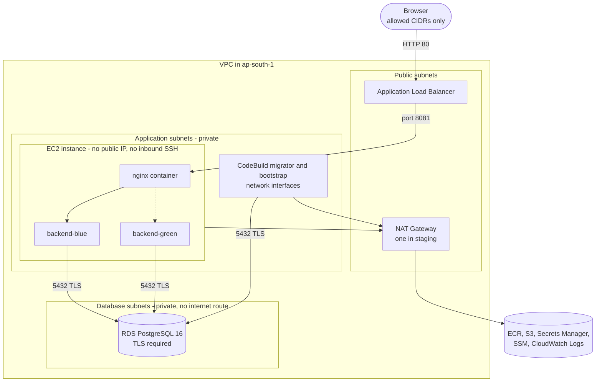

# AWS staging integration

How ShopNest is meant to run on AWS (staging), how a release gets there, how it is rolled back, and exactly what has and has not been proven.
This is the single reference for the AWS design; the README links here.

> **Status, 2026-11-21: designed, written and tested OFFLINE. Never run against AWS.**
> No AWS resource exists. No Terraform plan has been made for the current configuration and nothing has been applied. The CD and rollback workflows have never run.
> **Not proven:** an AWS deployment, zero downtime on AWS, a real automatic or manual rollback on AWS, the metadata-service isolation, the CodeBuild
> network paths, or that AWS accepts any of the IAM policies, SSM documents or CodeBuild projects. Where a sentence below describes behaviour, it
> describes what the code is written to do and what the offline tests show, never an observed AWS result.
>
> The code described here was merged into `main` through pull requests #22 to #26. Its offline suites and static checks ran and passed in GitHub Actions on those pull requests, which proves the code and its rules against fakes, not any behaviour on AWS. The CD and rollback workflows are on `main` but have never executed their jobs (`CD_ENABLED` is unset, so every CD run was skipped).

Contents: [1 Proof status](#1-proof-status) · [2 Architecture](#2-architecture) · [3 Identity and access](#3-identity-and-access) ·
[4 GitHub configuration](#4-github-configuration) · [5 Deployment sequence](#5-deployment-sequence) · [6 Rollback and exit codes](#6-rollback-and-exit-codes) ·
[7 Metadata-service (IMDS) isolation](#7-metadata-service-imds-isolation) · [8 Database, secrets and migrations](#8-database-secrets-and-migrations) ·
[9 CodeBuild connectivity](#9-codebuild-connectivity) · [10 Certificates](#10-certificates-the-rds-ca-bundle-and-the-user_data-download) ·
[11 Terraform prerequisites and planning](#11-terraform-prerequisites-and-planning) · [12 First bring-up order](#12-first-bring-up-order-when-approved) ·
[13 Tests](#13-tests-what-ran-and-what-they-prove) · [14 Unresolved decisions](#14-unresolved-decisions) · [15 Limitations](#15-limitations-and-residual-risks) ·
[16 Where things live](#16-where-things-live-and-stale-documents)

## 1. Proof status

| Claim | Status |
|---|---|
| The code, scripts, workflows, Terraform and tests described here exist | **Done** (merged into `main`, pull requests #22 to #26) |
| Blue/green decisions, exit codes 1 and 3, the guard's rules and fail-closed behaviour, the CI helpers, the workflow security rules, the IAM rules | **Tested offline** with fakes (counts in [section 13](#13-tests-what-ran-and-what-they-prove)) |
| Blue/green and rollback with real containers | **Tested on local Docker only** (earlier rehearsals, `docs/evidence/bluegreen-local/`), **before** the AWS-mode changes; the AWS-mode code paths have not been run with real Docker |
| Terraform accepted by AWS; a plan; an apply | **Not done** |
| Deployment on AWS, a live URL | **Not done** |
| Zero downtime on AWS | **Not proven** |
| Automatic or manual rollback on AWS | **Not proven** |
| Metadata-service isolation | **Designed and offline-tested; NOT proven** until the instance-level tests in [section 7](#7-metadata-service-imds-isolation) pass |
| CodeBuild reaching RDS, ECR, Secrets Manager and CloudWatch Logs from the private subnets | **Not proven** (a run-time pre-flight check exists, see [section 9](#9-codebuild-connectivity)) |
| The RDS CA bundle matches a checksum published by AWS | **Not verified** ([section 10](#10-certificates-the-rds-ca-bundle-and-the-user_data-download)) |

## 2. Architecture

### 2.1 Components (all `ap-south-1`, all described in Terraform, none created)

| Component | Staging design | Notes |
|---|---|---|
| **VPC** | one VPC; a range you choose in your untracked variable file | No range is written in the repository. |
| **Subnets** | two Availability Zones; per AZ one **public**, one **application (private)** and one **database (private)** subnet | The public subnets hold the ALB and the NAT Gateway. The application subnets hold the EC2 instance **and** the CodeBuild network interfaces. The database subnets have no route to the internet. |
| **NAT Gateway** | **one** in staging | A cost choice and a single point of failure for outbound traffic (SSM, ECR, Secrets Manager, CloudWatch Logs, package mirrors). Production is designed for one per AZ. |
| **Application Load Balancer** | internet-facing, HTTP on port 80 only, forwarding to the instance's Nginx port (8081 in staging) | **No HTTPS** (no domain or certificate; a recorded decision). The ALB security group accepts only the CIDRs you list in your untracked variable file; open-to-the-world is refused for staging. Health check: `/health`, expects 200. |
| **EC2** | one `t3.small`, Ubuntu 24.04, **private** (no public address), encrypted root volume, IMDSv2 required (hop limit 2) | No inbound SSH rule anywhere. Managed through Systems Manager. Runs Docker: Nginx plus the two backend colours. |
| **RDS PostgreSQL 16** | `db.t4g.micro`, single AZ, **private**, encrypted, TLS required (`rds.force_ssl`) | Master password generated and held by RDS in Secrets Manager (never in Terraform state). Staging: 1-day backups, no deletion protection, no final snapshot. |
| **ECR** | one repository, `shopnest/staging/backend` | Immutable tags (the commit SHA), scan on push, lifecycle keeps the newest 30 images. **No frontend repository**: see S3. |
| **S3 artifact bucket** | private, encrypted, versioned, TLS-only, public access blocked | Holds the release bundles (scripts, settings, frontend build) under `deploy/staging/<sha>/bundle.tar.gz`, and rollback "carrier" bundles. |
| **CodeBuild** (only when `enable_cicd` is true) | two projects in the **application subnets**: `migrator` (runs migrations) and `bootstrap` (creates the database roles, once) | One build at a time each. Each has its own security group and role. |
| **Systems Manager** | two command documents (deploy, rollback) with fixed commands and validated parameters | The only way the pipeline changes the instance. |
| **Secrets Manager** | `shopnest/staging/db-app`, `shopnest/staging/db-owner` (both created by the operator, outside Terraform), plus the RDS-managed master secret | Who may read which: [section 3](#3-identity-and-access). |
| **CloudWatch Logs** | one log group per CodeBuild project (30 days) | No application or VPC flow logging yet. |
| **IAM** | instance role; GitHub OIDC deploy role; migrator role; bootstrap role; operator role | [Section 3](#3-identity-and-access). |

The frontend is **not** an image: it is built by CI as static files, shipped inside the bundle, installed per release on the host, and served by a generic pinned Nginx container. The backend is the only image in ECR.

### 2.2 Network and services



Not shown: the instance's outbound paths all go through the NAT Gateway; the database has no outbound rule at all.

### 2.3 Who can reach what (security groups)

| Group | Inbound | Outbound |
|---|---|---|
| ALB | HTTP 80 from the allowed CIDRs only | the instance's Nginx port only |
| Application instance | the Nginx port, from the ALB group only | HTTPS and HTTP to the internet (through the NAT), PostgreSQL to the database group |
| Database | 5432 from the application group, the migrator group and the bootstrap group only | none |
| Migrator and bootstrap (CodeBuild) | none | PostgreSQL to the database group, HTTPS to the internet (through the NAT) |

There is no port 22 in any group.

## 3. Identity and access

### 3.1 The five identities

| Identity | Used by | It CAN | It can NOT |
|---|---|---|---|
| **Instance role** | the application host (and, by the metadata service, its backend containers) | register with Systems Manager; pull the one ECR repository; read the secret `db-app`; read `deploy/*` in the artifact bucket | read `db-owner` or the master secret; write to S3; send commands; start builds; assume other roles |
| **GitHub deploy role** | the CD and rollback workflows, through OIDC | push the backend image; upload bundles under `deploy/staging/` (**PutObject only**); start the migrator and read its result; send exactly the two SSM documents to exactly the instance; read command results and the migrator's log | read **any** secret; touch RDS, EC2, IAM or the bootstrap project; run an arbitrary command; read or list the bucket |
| **Migrator role** (CodeBuild) | the migration build | read `db-owner`; pull the backend image; write its own logs; create its network interface in the application subnets | read `db-app` or the master secret; use S3 or SSM |
| **Bootstrap role** (CodeBuild) | the one-time role bootstrap | read the master secret, `db-owner` and `db-app`; pull the image; write logs | anything else |
| **Operator role** | a person, **with MFA** | start and inspect the bootstrap build; read its logs | anything else |

### 3.2 Who can read which secret

| | `db-app` | `db-owner` | RDS master |
|---|---|---|---|
| Backend container (through the instance role) | yes | **no** | **no** |
| nginx container | no | no | no |
| Instance role / host | yes | **no** | **no** |
| GitHub deploy role | no | no | no |
| Migrator role | no | yes | no |
| Bootstrap role | yes | yes | yes |
| Operator (their own account) | by their own rights | by their own rights | by their own rights |

The host is also not told where the owner or master secrets are: the host settings file refuses those names.

### 3.3 GitHub OIDC

- No AWS access key exists. The deploy job exchanges its short-lived GitHub OIDC token for the deploy role's temporary credentials (one hour at most).
- **Trust:** only GitHub's token provider, for the STS audience, with a subject that matches **exactly** one value you list (`StringEquals`, no wildcard). A different repository, branch or environment cannot assume the role.
- **The real subject claim must be captured from a workflow run**, not guessed: a newer repository may use ID-based, immutable claims. Terraform refuses to enable CI/CD without it.
- **An account can hold only one GitHub OIDC provider.** Whether one already exists is unknown: check first (a read-only AWS call that needs approval), then either create it or reference the existing one. Terraform requires exactly one of the two settings.
- The workflows never use GitHub secrets.

### 3.4 What an administrator can still do

IAM cannot stop an administrator of the account from starting the bootstrap build or reading a secret. The operator role narrows the **intended** path; it is not a barrier against an administrator.

## 4. GitHub configuration

**Nothing is configured today** (as of 2026-11-21: 0 secrets, 0 variables, 0 Environments). Creating any of the following is a GitHub settings change and needs separate approval. **Values are never written here.**

### 4.1 Repository variable

| Name | Purpose |
|---|---|
| `CD_ENABLED` | The master switch. Unless it is exactly `true`, the CD workflow is skipped and the rollback workflow **refuses** (it fails, it does not silently skip). |

### 4.2 `staging` GitHub Environment variables (non-secret)

| Name | Purpose | Where the value comes from |
|---|---|---|
| `AWS_ROLE_ARN` | the role the workflow assumes through OIDC | Terraform output `github_deploy_role_arn` |
| `AWS_REGION` | the region | `ap-south-1` |
| `ECR_REPOSITORY` | the repository the image is pushed to, by **name** (not the registry URL) | `shopnest/staging/backend`, i.e. `<project>/<environment>/backend`. No Terraform output returns the bare name: `ecr_repository_urls` returns registry URLs, so take the name from `ecr_repository_names` (default `backend`) or from the URL's path |
| `ARTIFACT_BUCKET` | the bucket the bundle is uploaded to | Terraform output `artifact_bucket_name` |
| `MIGRATOR_PROJECT` | the CodeBuild migrator project | Terraform output `migrator_project_name` |
| `SSM_DEPLOY_DOCUMENT` | the deploy command document | Terraform output `ssm_deploy_document_name` |
| `SSM_ROLLBACK_DOCUMENT` | the rollback command document (used by `rollback.yml`) | Terraform output `ssm_rollback_document_name` |
| `STAGING_INSTANCE_ID` | the application instance | Terraform output `instance_ids` |

There are **no GitHub secrets** in this design. The old SSH names (`SSH_PRIVATE_KEY`, `SSH_KNOWN_HOSTS`, `EC2_HOST`, `EC2_USER`, `SSH_SG_ID`) are obsolete and a CI check fails if they reappear in the deployment workflows. A `staging` Environment with a required reviewer is recommended so that nobody deploys by accident; it is not configured.

## 5. Deployment sequence

Triggered by `cd.yml` after the CI workflow **succeeds** on the latest commit of `main`, and only when `CD_ENABLED` is `true`.

```mermaid
sequenceDiagram
  autonumber
  participant CI as CI (ci.yml)
  participant CD as cd.yml
  participant ECR as ECR
  participant CB as CodeBuild migrator
  participant RDS as RDS
  participant S3 as S3
  participant SSM as Systems Manager
  participant EC2 as Instance (blue/green scripts)
  CI->>CD: succeeded for the latest main commit
  CD->>CD: package job: build the image, build ONE bundle (hash recorded)
  CD->>ECR: push the image under the immutable commit tag, read back the DIGEST
  CD->>CB: start the migrator inside that image (by digest)
  CB->>RDS: apply pending migrations (advisory lock, TLS verified, owner role)
  alt migration fails
    CB-->>CD: build failed
    CD-->>CD: stop: NOTHING is deployed
  else migration succeeds
    CD->>S3: upload the bundle (this environment's prefix)
    CD->>SSM: send the deploy document (commit, image digest, bundle key, bundle SHA-256)
    SSM->>EC2: fetch the bundle, VERIFY its SHA-256, only then extract
    EC2->>EC2: install and apply the metadata guard, pull the image BY DIGEST
    EC2->>EC2: prove the isolation (probe and nginx must fail to reach IMDS)
    EC2->>EC2: start the idle colour, require /health OK and /version == commit
    EC2->>EC2: move traffic, verify live, drain; on failure, return to the previous release
    EC2-->>SSM: exit code 0, 1 or 3
    SSM-->>CD: result (0 / 1 / 3, or 4 if it cannot be confirmed)
  end
```

Step by step:

1. **Gate.** CI succeeded, for a push to `main`, from this repository, and the commit is still the tip of `main`; otherwise nothing runs.
2. **Package.** The backend image is built with its revision label set to the commit. One reproducible bundle is built from an explicit file list (scripts, settings, Nginx config, the guard, and the frontend build). The build refuses a frontend without a non-empty `index.html`. The bundle's SHA-256 is recorded.
3. **Deploy job** (`staging` Environment, OIDC, one hour):
   1. The bundle hash is re-checked **before** AWS is touched.
   2. The image is pushed under an immutable tag, but only if its revision label equals the commit. A re-run reuses the existing tagged image. The **digest** is read back from ECR; everything downstream uses the digest, never a tag.
   3. **Migrations run in CodeBuild, inside that exact image.** If they do not succeed, the job stops here and **nothing is deployed**. There is no `continue-on-error` anywhere on this path (a static check enforces it).
   4. The bundle is uploaded to `deploy/staging/<commit>/bundle.tar.gz`.
   5. The deploy document is sent to the instance. The workflow waits and reports the result.
4. **On the instance** (the document runs the bundle's `bluegreen-deploy.sh`):
   1. every argument is validated **before** anything changes (the image must be a digest from this environment's repository and region; the bundle reference must have the expected shape);
   2. the host guard is installed and applied, the container network created if missing ([section 7](#7-metadata-service-imds-isolation));
   3. the image is pulled by digest and its revision label checked; the digest and the bundle reference are **recorded** for rollback;
   4. the RDS endpoint must accept a TCP connection (this proves the network path only);
   5. the isolation is verified; if it cannot be confirmed the deploy **stops before any container starts** (fail closed);
   6. the idle colour starts, must report healthy and the expected commit, and only then does Nginx switch; failures after the switch return traffic to the previous release.
5. **The host never runs migrations and cannot seed.** It never holds the owner credentials.

**Production is not deployed by this workflow.** No production infrastructure exists. A final job only writes a notice in the run summary.

## 6. Rollback and exit codes

### 6.1 Automatic rollback (inside a deploy)

A release that fails its checks before the switch never receives traffic. A failure **after** the switch returns traffic to the previous release, which is verified again. This logic is unchanged from the local design and was rehearsed in **local** Docker before the AWS-mode changes; it has not been exercised on AWS. A fault that appears only after traffic moves still costs a short window of failed requests before the reversal (about 20 seconds in the local rehearsal): the failure is recovered, not invisible.

### 6.2 Manual rollback (`rollback.yml`)

Staging only. It **fails closed**:

- a request for **production** is refused with an error (production rollback is not implemented);
- a request while `CD_ENABLED` is not `true` is refused, **not** silently skipped;
- a request from any ref other than `main` is refused;
- the target must be an ancestor of `main`.

It then builds a small "carrier" bundle of the current `main` tooling (scripts and settings only). Its S3 key is derived from its own content, so it can never overwrite a release bundle. The instance verifies the carrier's SHA-256 before extracting it and runs `rollback.sh`, which:

- refuses a release that is not recorded as deployed;
- pulls the **recorded image digest** again if the host no longer has the image, and refuses if ECR no longer has it (the ECR lifecycle keeps only the newest 30 images);
- restores the **recorded frontend artifact** from S3 if the files are gone, after verifying its SHA-256, and refuses otherwise;
- starts the release on the idle colour, requires health and the commit, then switches.

### 6.3 The database is never rolled back

A rollback **never runs migrations** and **never reverses the schema**; a static check enforces that the rollback workflow does not start CodeBuild. Migrations are written to stay compatible with the release still serving (add first, remove later). A bad schema change is fixed forward with a new migration, or recovered by a point-in-time restore. Staging keeps backups for only one day, so a restore must be decided quickly.

### 6.4 Exit codes

| Code | Meaning | Where it comes from |
|---|---|---|
| **0** | success: the release is live / the rollback is done | deploy and rollback scripts, carried back through SSM |
| **1** | failed, and the **previous release is still serving** (or the live release was restored) | scripts, through SSM; also `run-codebuild.sh` for a build that failed or did not finish |
| **2** | bad arguments | scripts and helpers |
| **3** | failed **and the recovery failed**: the environment may be serving a release that did not verify. **An operator is needed now.** | scripts, through SSM |
| **4** | the result **could not be confirmed**: the command could not be sent, was cancelled or timed out, did not finish in time, or ended with an unexpected code | `run-ssm-command.sh`. Treat as a failure and look at the instance |

A command that reports "success" status with a non-zero code is **not** treated as success. Codes 1 and 3 are covered by the offline suites; **no real-AWS code 3 has ever been observed.**

## 7. Metadata-service (IMDS) isolation

> **Not proven.** Everything in this section is design plus offline tests with a fake `iptables` and fake Docker. It becomes a verified property only when the instance-level tests below have passed on a real instance, and this document must be updated with their results.

### 7.1 The problem

The backend must read the `db-app` secret with the AWS SDK, using the instance role. That needs the metadata service, with the IMDSv2 hop limit at 2 so a container can reach it. Left alone, **every** container on the host could then read the same credentials, including nginx.

### 7.2 The design

- **A dedicated, external Docker network** with a fixed subnet. Nginx, `backend-blue` and `backend-green` have **fixed addresses** on it.
- **One source of truth for the addresses:** `deploy/env/<environment>.env` (`EDGE_NETWORK`, `EDGE_SUBNET`, `EDGE_IP_RANGE`, `EDGE_GATEWAY`, `NGINX_IP`, `BACKEND_BLUE_IP`, `BACKEND_GREEN_IP`). Compose and the guard both read it; a test and a CI step assert they agree, and the guard refuses an inconsistent file (addresses outside the subnet, duplicates, a fixed address inside the automatic range, the metadata address inside the subnet).
- **How the addresses stay fixed:** the network is created once by the guard with a fixed subnet and an automatic-assignment range in the **upper half**; the fixed addresses are outside that range, so no container started without a fixed address can ever take one. The network is external, so `docker compose down` does not delete it. If the network exists with a different subnet, the deploy refuses to continue (the rules depend on the addresses). Recreating a colour keeps its address because the address is part of its service definition.
- **The rules:** a dedicated chain, jumped to **first** from Docker's `DOCKER-USER` chain: accept from the blue address, accept from the green address, **drop everything else** to the metadata address. The chain is replaced in a single atomic restore, so there is no moment without rules, and the jump is kept first and unique.
- **No capabilities:** every container drops all Linux capabilities (this also removes the ability to forge another container's source address) and cannot gain privileges.
- **Fail closed:** before any release starts, a throwaway **probe container** (no capabilities, not at an allowed address) must **fail** to connect to the metadata address, and the running nginx must fail too. If either can connect, or the probe cannot run, the deploy **stops before any container starts**. A rollback is stopped the same way.
- **Only the backend keeps access**, so it can read `db-app`. It is the only container that needs the instance role.

### 7.3 Surviving deployments and reboots

| Event | How the rules persist | Status |
|---|---|---|
| A deploy | every deploy reinstalls the guard from the checksum-verified bundle, re-applies the rules and re-verifies, **before** any container starts | tested offline |
| Recreating a backend colour | its fixed address is part of the service definition | tested offline (static); **not run** with real Docker |
| `docker compose down` | the network is external and is not removed | **not run** |
| A Docker restart | a systemd unit ordered after Docker and tied to it re-applies the rules | **not run** |
| A reboot | the guard and its settings are installed on the host (`/usr/local/sbin`, `/etc/shopnest`), so no bundle is needed; the unit re-applies the rules; a timer re-checks every minute and repairs drift | **not run** |

**Unresolved risk, the boot race:** containers with `restart: unless-stopped` can start in the seconds before the unit applies the rules. Whether Docker preserves rules that are created before it starts is unverified. If it does, the unit can run before Docker; if not, the fallback is to stop auto-restarting the containers and start the stack from a unit that first verifies the guard. This will be decided from the instance test (G12), not assumed.

### 7.4 Residual risk: a compromised backend

The backend can still reach the metadata service, so **a compromised backend would hold the instance role**: Systems Manager registration (it could speak to the SSM service as the instance), pull access to the one ECR repository, read access to `deploy/*` in the artifact bucket, and the `db-app` secret. It still **cannot** read `db-owner` or the master secret, and it cannot change the schema or the roles. This is accepted for staging and documented. Stronger options (a role-chained credential proxy that gives the backend a role limited to `db-app`, or having the host read the secret so the container has no cloud credentials at all) were considered and not chosen for staging.

### 7.5 Instance-level verification (all PENDING)

| ID | Test | Expected | Status |
|---|---|---|---|
| G1 | the rules are present (`imds-guard check`) | passes | pending |
| G2 | the nginx container requests the metadata service | fails | pending |
| G3 | a probe container (any other address) requests it | fails | pending |
| G4 | a backend container obtains an IMDSv2 token and reads `db-app` | succeeds | pending |
| G5 | a backend container tries to read `db-owner` and the master secret | access denied | pending |
| G6 | a container tries to open a raw socket / forge an address | refused | pending |
| G7 | after a reboot, G1 to G3 | still hold | pending |
| G8 | after a Docker restart, G1 to G3 | still hold | pending |
| G9 | a repeat deploy | idempotent, rules unchanged | pending |
| G10 | a recreated backend | keeps its address | pending |
| G11 | `docker compose down` | the network and rules remain | pending |
| G12 | the window between boot and the rules applying | measured | pending |

## 8. Database, secrets and migrations

- **Roles.** `shopnest_owner` (migrations; owns the objects) and `shopnest_app` (the API; explicit per-table grants, update only the stock column, no DDL, no delete). Neither is a superuser. The master user (`rds_superuser`) is used only by the bootstrap.
- **Secrets** are JSON `{"username": ..., "password": ...}`, created **by the operator, outside Terraform**, so no value ever enters Terraform state: `shopnest/staging/db-app` (user `shopnest_app`) and `shopnest/staging/db-owner` (user `shopnest_owner`). The passwords must be 24 or more letters and digits, different from each other. Generate them with a tool such as `openssl rand -hex 16`, put them in a file that is not in the repository, create the secret from that file, and delete the file; never type them on a command line or into a document.
- **The backend** reads its secret once at start-up through the AWS SDK and connects to RDS over TLS, **verifying** the server certificate and host name against the pinned CA bundle inside the image. There is no setting that disables verification. It refuses to start if both `DATABASE_URL` and the RDS settings are present. Rotation is not handled: a rotated secret needs a restart.
- **Migrations** run in the CodeBuild migrator, as the owner, **before** the deploy, under a PostgreSQL advisory lock (so two runs can never interleave; one build at a time is the first defence). They must stay compatible with the release still serving. A failed migration blocks the deployment. They are never reversed automatically.
- **Role bootstrap** runs **once**, in the separate `bootstrap` CodeBuild project, started **only** by the operator role (with MFA). It refuses to run outside CodeBuild and refuses unless the operator supplies `BOOTSTRAP_CONFIRM=bootstrap-staging` when starting the build. It runs all its statements in one transaction and prints attributes only, never a secret. **It is unverified on a real RDS instance:** the master user is `rds_superuser`, not a real superuser, and some statements (notably handing the database to the owner) are only provable against a real instance.
- **Migration 003** grants the API role its table privileges only if the role exists, and does nothing otherwise. If the bootstrap has not run, the application would fail at runtime with "permission denied". Nothing checks this at deploy time yet.
- **Host settings** (`/home/deploy/shopnest/staging/runtime.env`) are written once by the operator and hold **non-secret** values only: the database host, name and region, the `db-app` secret id, the ECR repository and the artifact bucket. The file is parsed, never executed, and the host refuses any other name (so it can never be told where the owner or master secret is).

## 9. CodeBuild connectivity

The migrator and bootstrap run in the **application (private) subnets**. They need these network paths, and **none has been verified on AWS**:

| Need | Provided by (design) |
|---|---|
| RDS, port 5432, TLS | the job's security group allows egress to the database group; the database group allows ingress from the job's group |
| ECR (the API, and image layers from S3) | outbound HTTPS through the NAT Gateway; the project's role pulls the release image |
| Secrets Manager | outbound HTTPS through the NAT Gateway |
| CloudWatch Logs | outbound HTTPS through the NAT Gateway |
| A network interface in the subnet | an IAM permission limited to the application subnets and to the CodeBuild service |

The route to the NAT Gateway from the application subnets was visible in an earlier Terraform plan, but a plan is not a connectivity test. **A pre-flight script runs first in both builds** (`check-connectivity.js`): it opens a plain TCP connection to the database, the ECR API, Secrets Manager and CloudWatch Logs, sends no credentials, and fails the build with a clear message if one is unreachable. It does **not** test the image registry host or S3 (the image is pulled by CodeBuild before the build starts), so a failure there would appear as a failed image pull. All of this is unproven until the first real run.

## 10. Certificates: the RDS CA bundle and the user_data download

- **Pinned bundle (used by the application):** `backend/certs/rds-global-bundle.pem`, baked into the backend image. Recorded source: `https://truststore.pki.rds.amazonaws.com/global/global-bundle.pem`, retrieved 2026-11-21 over HTTPS; 174,560 bytes; SHA-256 `90a6f1a7978a1b1b096dca6c57511ca48d3b8cf052f8e704baf358f34ea2f21b`. It holds 114 self-signed roots issued by Amazon RDS, none expired, including the three for `ap-south-1`. A test pins the hash so any later change fails CI.
- **Limitation, stated plainly: the checksum is NOT verified against an AWS-published value.** The checksum URLs AWS appears to offer answered HTTP 403, and the documentation page shows none in its static text. The recorded hash is a record of what was downloaded, not a comparison. Before relying on it for production, compare it with the checksum shown in the AWS documentation ("Using SSL/TLS to encrypt a connection to a DB instance") and record the result in `backend/certs/README.md`.
- **The `user_data` CA download (unverified, and now unnecessary).** The instance boot script still downloads the same bundle to `/opt/shopnest/rds-global-bundle.pem` over HTTPS with **no fingerprint check**, and installs a PostgreSQL client "for operator work". Nothing uses either any more: the application uses the pinned copy in its image, and bootstrap runs in CodeBuild. It was deliberately **left unchanged** so the instance part of the Terraform plan did not change. Removing it is a Terraform change that needs approval and a re-plan.

## 11. Terraform prerequisites and planning

### 11.1 Before any plan

| Need | Detail |
|---|---|
| Tooling | Terraform 1.17.x; AWS provider 6.x (the lock file pins it) |
| AWS identity | the `devops` CLI profile with short-lived credentials; never root credentials, never a permanent access key; never the `lab` profile |
| Untracked variable file | `infra/terraform/staging.tfvars` (git-ignored): `environment = "staging"`, `allowed_account_ids`, `vpc_cidr`, `alb_allowed_cidrs`, plus the staging settings from `staging.tfvars.example`. **None of these values belongs in the repository.** |
| Workspace | `terraform workspace new staging` (once), then select it. The configuration refuses to plan in any other workspace |
| State | local and git-ignored: no locking, no versioning; back it up; never commit it; it can hold sensitive attributes |
| For the CI/CD resources | set `enable_cicd = true` (default **false**) **and** supply: `github_repository`; the real `github_oidc_subjects`; exactly one of `create_github_oidc_provider = true` or `github_oidc_provider_arn`; and at least one `operator_principal_arns`. Terraform refuses otherwise |
| Read-only AWS checks (need approval) | whether a GitHub OIDC provider already exists; the available PostgreSQL 16 minor versions; that the applying identity may create everything in the plan (the policy simulator) |

### 11.2 A fresh plan is required; the earlier `staging.tfplan` must not be reused

A saved plan was produced on 2026-11-21 (54 resources to add, none to change or destroy). **It must not be applied.** It was made before the CI/CD work: afterwards, new variables, outputs and three new Terraform files were added, and a documentation string changed. Specifically:

- it does not describe the current configuration, so applying it would deploy an **outdated** design without the CI/CD resources, and nobody has reviewed that combination;
- a saved plan is only valid against the exact state and configuration it was made from; AWS or the local state may have changed since;
- it was made with values from the untracked variable file, so it contains them: treat it as sensitive, keep it local and discard it.

**Required:** make a new plan from the current configuration and your current `staging.tfvars`, **review it**, and apply **only the new, reviewed plan**, **only after your explicit approval in that turn**. No plan has been made for the current configuration. With `enable_cicd` left at `false`, a fresh plan is expected to show the same 54 resources plus new, empty outputs; that expectation has not been checked.

### 11.3 Cost

The Terraform README (`infra/terraform/README.md`, section 12) estimates roughly $102 to $125 a month for staging running continuously, mostly the NAT Gateway and the ALB. It is an estimate, not a quote, and it predates CodeBuild and CloudWatch Logs, which are small (builds are billed per minute and only run on deploys); those are **not** estimated. Destroying staging between sessions needs approval.

## 12. First bring-up order (when approved)

Nothing below has been done.

1. **Plan and apply the infrastructure** ([section 11](#11-terraform-prerequisites-and-planning)). Approval for the apply, in that turn.
2. **Create the two secrets** (operator, own credentials, no value in any file or log).
3. **Write the host settings** on the instance (operator, in a Systems Manager session): the database host, name and region, the `db-app` secret id, the ECR repository and the artifact bucket. Not the owner or master secret.
4. **Set the GitHub Environment variables** and `CD_ENABLED` (needs approval).
5. **Chicken-and-egg, by design.** The bootstrap needs a release image in ECR, and the first deploy's migration step needs the roles the bootstrap creates. So the **first deploy attempt will stop at the migrator** (the roles do not exist, so the login is refused): that is the intended fail-closed behaviour, and it leaves the image in ECR. The operator then assumes the operator role (with MFA) and starts the **bootstrap** with that image's digest and `BOOTSTRAP_CONFIRM`, and then **re-runs the deploy**.
6. **Verify the instance-level tests** (G1 to G12) and record the results here.

## 13. Tests: what ran and what they prove

The counts below are from **local, offline runs on 2026-11-21**. The same suites also ran, and passed, in GitHub Actions: the blue/green, guard, CI-helper, SSM-script and workflow suites in the "Deploy scripts and Compose" job, and the IAM rules in Terraform CI, on pull requests #24 to #26. One CI-helper assertion failed in its first GitHub run (it depended on a Git file mode that Windows hides) and was corrected; the failed run remains in the Actions history.

| Suite | Result | What it proves | What it does not |
|---|---|---|---|
| Backend (Vitest) | 160 passed, 11 skipped | the TLS and secret handling, the advisory lock, the bootstrap statements (against a fake connection), the connectivity check, the pinned CA | the skipped PostgreSQL integration tests need a live database (CI runs them); nothing ran against RDS |
| Blue/green offline suite | 305 passed, 0 failed | deploy and rollback decisions in both modes, argument validation before any change, exit codes 1 and 3, the guard's use, bundle and image-digest recording, frontend restore | real containers, nginx or Docker behaviour |
| Host guard suite | 135 passed, 0 failed | the exact rules and their order, idempotence, drift detection, fail-closed verification, the installer, the units | that a real instance blocks anything |
| CI-helper suite | 146 passed, 0 failed | the bundle contents and reproducibility, image push rules, a failed migration blocking the deploy, exit-code mapping, rejection of anything that could become a command | AWS behaviour |
| Workflow static checks | 68 passed, 0 failed | no SSH, no stored credential, pinned actions, OIDC only where needed, migration order, fail-closed rollback, the contract with the SSM document patterns | that the workflows run |
| Terraform static IAM checks | 97 passed, 0 failed | who may do what, the gating, no wildcard actions, the instance role cannot reach the owner or master secret | what AWS accepts |
| `terraform fmt` and `validate` | pass | the configuration is well-formed | that it can be planned or applied |
| ShellCheck (every shell file under `deploy/`), actionlint (every workflow) | clean | lint | behaviour |
| Secret scan (working tree) | 2 findings, both in the git-ignored `staging.tfvars` | nothing committed matches the rules | that no secret exists |

The checks also detect deliberate breakage: the workflow checker caught 16 of 16 injected faults, the contract check 6 of 6, the Terraform IAM check 10 of 10, and the compose assertions 17 of 17.

## 14. Unresolved decisions

| Decision | State |
|---|---|
| **How staging gets a demo catalogue.** The seed policy refuses `staging`, and the instance can no longer seed (it never holds the owner credentials). Options: allow a deliberate, flagged seed in the migrator; insert products by a one-off operator SQL; or run staging with an empty catalogue | **Unresolved** |
| SSM instead of SSH, against the assignment's "deployment over SSH" wording | **Waiting for the instructor.** Not assumed acceptable |
| A live URL and whether an address may appear in the repository | **Waiting for the instructor.** No address is written anywhere |
| HTTPS | HTTP only for now (no domain); a recorded decision |
| Whether a GitHub OIDC provider already exists in the account | **Unknown**; needs a read-only AWS check |
| The boot race and the exact unit ordering for the metadata guard | Decided by instance test G12 |
| Removing the unverified CA download and the unused client from `user_data` | Needs a Terraform change, approval and a re-plan |
| Production deployment and production rollback | Not implemented; refused explicitly |
| Secret rotation | Not handled |
| Remote Terraform state with locking, VPC flow logs, alarms | Later |
| The AWS-published checksum for the RDS CA bundle | To be compared by the owner |

## 15. Limitations and residual risks

- Everything in [section 1](#1-proof-status) marked not proven.
- A compromised backend holds the instance role ([section 7.4](#74-residual-risk-a-compromised-backend)).
- One instance and one NAT Gateway: staging has no redundancy; an Availability Zone failure takes it down.
- A fault that appears only after traffic moves still causes a short window of errors before the reversal (about 20 seconds measured locally).
- Staging data has no safety net beyond one day of backups, and no final snapshot on deletion.
- The ECR lifecycle keeps 30 images: a rollback to an older release can be refused if its image has expired.
- `rds_superuser` limits are unverified against the bootstrap statements.
- The CI job that runs the offline suites has a 20-minute limit chosen as a margin; its real duration on a GitHub runner is not known.
- Output of an SSM command is truncated at 24,000 characters by AWS; the deploy scripts also write a full log on the host.

## 16. Where things live, and stale documents

| What | Where |
|---|---|
| Workflows | `.github/workflows/cd.yml`, `rollback.yml`, `ci.yml`, `terraform-ci.yml` |
| CI-side helpers (bundle, image push, migrator, SSM runner) | `deploy/ci/` |
| Host scripts, systemd units | `deploy/host/` |
| Deploy and rollback scripts, shared library | `deploy/scripts/` (`bluegreen-deploy.sh`, `rollback.sh`, `lib/bluegreen-lib.sh`) |
| CodeBuild build specifications | `deploy/codebuild/` |
| Compose files | `deploy/docker-compose.prod.yml` (AWS), `deploy/docker-compose.local-db.yml` (laptop rehearsal only) |
| Per-environment non-secret settings, including the container-network addresses | `deploy/env/` |
| Terraform | `infra/terraform/` (`github_oidc.tf`, `codebuild.tf`, `ssm_documents.tf` are the CI/CD part) |
| Backend database, secret, bootstrap and connectivity code; the pinned CA | `backend/src/`, `backend/scripts/`, `backend/certs/` |
| Tests | `deploy/tests/`, `backend/test/` |

**Documents that still describe the earlier, SSH-based design and were not updated in this documentation pass:** `docs/ARCHITECTURE.md`, `docs/OIDC_DESIGN.md`, `docs/GITHUB_SETUP.md`, and parts of `infra/terraform/INTEGRATION_GAPS.md`, `infra/terraform/README.md` and `CLAUDE.md`. Where they disagree with this file about deployment, **this file is current**. Updating them is a separate task.
