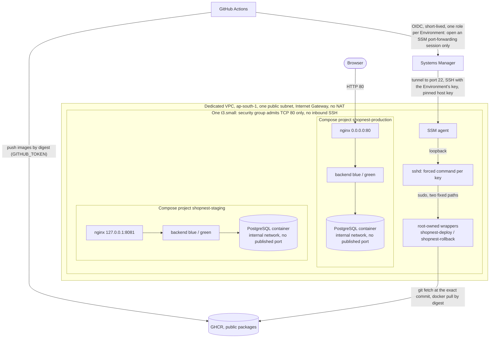
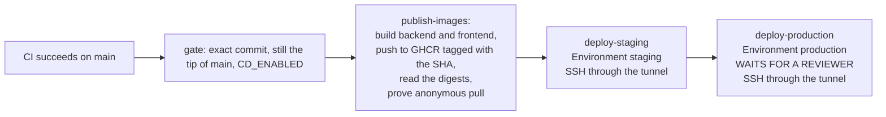

# Lab deployment: one EC2 instance, GHCR images, SSH through a Systems Manager tunnel

Status (2026-11-25): **staging has been deployed once for real** (CD run [45469834249](https://github.com/Bhabotos/shopnest-devops-cicd/actions/runs/45469834249), commit `3c53ba7`). The deployment code is merged; the instance, the two OIDC deploy roles and the GitHub Environment configuration exist. **Production has not been deployed** (its job waits for the reviewer). Zero downtime and rollback on the instance are still to be demonstrated.
Every statement below says whether it is implemented, tested offline, or **needs a real demonstration**. This document describes the current deployment target. It replaces, for deployment, the design in
[`AWS_STAGING_INTEGRATION.md`](AWS_STAGING_INTEGRATION.md) (RDS, ECR, ALB, NAT, CodeBuild, S3 bundles), which stays in the repository as the earlier, larger design and is no longer used by `cd.yml` or `rollback.yml`.

## Decisions this implements

| # | Decision | Where it shows up |
|---|---|---|
| 1 | Deployment over **SSH, carried through an AWS Systems Manager port-forwarding tunnel**: the instance has **no inbound port 22**, and Part E's "over SSH" is met literally | `deploy/ci/ssh-deploy.sh`, `deploy/host/*`, `cd.yml`, `rollback.yml` |
| 2 | A **public live URL** for production only | `http://<public address>/` (see [Live URL](#live-url)) |
| 3 | **Inbound HTTP 80** is the only inbound rule | `infra/lab/security_groups.tf` |
| 4 | **One secret per Environment**: `DEPLOY_SSH_KEY`, a different ed25519 key for staging and for production | the Environment's secret; the public keys are bound to their Environment on the host |

The earlier design of this lab sent fixed Systems Manager Run Command documents instead of SSH. That path is retired: the workflows do not use it, and the optional documents in `infra/lab/ssm_documents.tf` are disabled by default.

## Architecture



Staging is **not reachable from the internet** (only port 80 is open, and staging listens on the loopback address; it is reached through a Session Manager port forward). The databases have **no published port and sit on an `internal: true` network**. Each environment is its own Compose project with its own database container, volume, network and secrets directory, so a staging deploy cannot touch production's data.

## The deployment sequence (`cd.yml`)



Each deploy job installs the **pinned Session Manager plugin first** (version and SHA-256 pinned, checked before installation), then exchanges its GitHub OIDC token for the Environment's role (the AWS account id is masked in the logs), then runs `deploy/ci/ssh-deploy.sh`:

1. write the Environment's key to a private temporary file (never printed, deleted on every exit path) and the pinned host key to a private `known_hosts`;
2. open the tunnel (`AWS-StartPortForwardingSession` to port 22), and run a **pre-flight** `--check` over SSH that proves the tunnel, the key, the pinned host key (`StrictHostKeyChecking=yes`) and the arguments before anything starts;
3. run the real command. The key's forced command (`shopnest-ssh-entry`) accepts only `shopnest-deploy` or `shopnest-rollback` with exactly one `--env`, equal to the key's own Environment, and starts the root-owned wrapper with `sudo`;
4. the wrapper validates every argument again (both images must be digests of this owner's ShopNest images; a 40-hex commit), requires the commit to be part of `main` (asked of GitHub, fail closed), fetches that commit into a root-only directory and runs the repository's own blue/green script;
5. the blue/green script pulls both images **by digest** and requires each image's revision label to equal the commit, starts the environment's PostgreSQL container if needed (never recreated), applies the migrations as the owner role, starts the idle colour, requires `/health` OK and `/version == the commit`, switches nginx in one reload and verifies again. Before the switch traffic never moves; after it, a failed check returns traffic to the previous release (automatic rollback);
6. the client only reports success if the host's own output confirms that **this commit** went live from **these digests**; the tunnel, the SSM session and the key are then cleaned up.

Concurrency: each Environment has its own group (`deploy-lab-staging`, `deploy-lab-production`). A job waiting for its reviewer keeps its group, so a single shared group let the waiting production job block every later staging deploy (found on the first real run); the host's own lock in the wrapper still serializes everything on the instance.

Exit codes: `0` deployed and confirmed; `1` failed with the previous release serving; `3` failed **and** the recovery failed (an operator is needed now); `4` the result could not be confirmed. The log is written on the host (`/opt/shopnest/logs/`), printed in the job, and uploaded as an artifact kept for 30 days (account and instance ids are redacted from the error text). Every deploy is traceable to its commit: the images carry it as a tag and a label, `/version` reports it, the history file on the host records it, and the run summary lists the commit and both digests.

**Production** is deployed only by `deploy-production`, bound to the `production` GitHub Environment: GitHub holds it until the required reviewer approves, it runs only after staging deployed, its AWS role trusts only the production Environment's OIDC subject, and its key is bound to production on the host. A deploy never seeds production.

## Checking staging from outside (`staging-verify`)

The manual `staging-verify` workflow opens a Systems Manager port-forward to the staging nginx (loopback port 8081 on the instance) with the staging role, no SSH key. Mode `verify` checks the frontend, `/health`, that `/version` is **not** exposed on the public origin (it is internal by design; the deploy script reads it inside the host, so the host log is the authoritative record of the running commit) and a database-backed `/api/products`; mode `traffic` runs `request-loop.sh` for the Part F evidence while a staging deploy happens. It changes nothing and never touches production.

## Rollback (`rollback.yml`)

A manual workflow: choose `staging` or `production` and a full commit SHA that was **deployed earlier**. It is refused (not skipped) while `CD_ENABLED` is not `true`, from any ref other than `main`, or for an unknown environment. The target must be an ancestor of `main` (checked in the workflow) and must appear as `deployed` in the release history on the host (checked by `rollback.sh`). The scripts that run as root come from the **tip of `main`** (the wrapper refuses an older carrier commit); the target is started on the idle colour and must pass the **same validation as a deploy** before traffic moves. If the host lost the images it pulls the recorded digests again from GHCR. A rollback **never runs migrations**. A production rollback waits for the same reviewer approval.

## Part G demonstrations (staging only)

**Automatic rollback with a deliberately unhealthy staging release.** `bg_release` already returns traffic to the previous release when the post-switch verification fails. To provoke that for real without putting broken code on `main`, staging has a one-shot fault (`bg_fault_arm` in `deploy/scripts/lib/bluegreen-lib.sh`, tested in `deploy/tests/lab-mode.test.sh` section 8):

1. **Arm it** (only a person with a root shell on the instance can; the deploy user and the workflows cannot create the file). In a Session Manager session:
   ```bash
   printf 'FAULT=post-switch-unhealthy
' | sudo tee /opt/shopnest/staging/fault.env > /dev/null
   sudo chown root:root /opt/shopnest/staging/fault.env && sudo chmod 600 /opt/shopnest/staging/fault.env
   ```
   Check what you created before deploying: `sudo stat -c '%U:%G %a %n' /opt/shopnest/staging/fault.env` must print `root:root 600 /opt/shopnest/staging/fault.env`. Every staging deploy also logs a line saying whether it found a fault file at that path (and lists any file named `*fault*` under `/opt/shopnest` by name, owner and mode only), so a file in the wrong place is visible in the deploy log.
2. **Trigger a staging deploy** (merge any small pull request to `main`, or re-run the latest successful CI run on `main`). The deploy starts the new colour, validates it, switches traffic, and then the fault consumes itself: the file is deleted, the new release's post-switch verification is reported as failed, and the real automatic rollback returns traffic to the previous release and verifies it. The workflow job ends with exit 1 ("the deploy failed; the previous release is still serving"), and the production job never runs (`needs: deploy-staging`).
3. **Evidence**: the failed CD run, its `deploy-log-staging-...` artifact (it contains `FAULT INJECTION (staging test): armed for release ...`, `post-switch verification FAILED`, `previous release ... is live again (automatic rollback complete)`), and a `staging-verify` run showing staging healthy on the previous release.

**The REAL fault (a genuinely broken backend, no user impact).** Arm the single line `FAULT=backend-unhealthy-pre-switch` instead (same file, same owner and mode). The next staging deploy then freezes the new colour's container right after it starts (`docker pause`), so its health checks really fail; readiness is retried for about 60 s, the release is rejected before any traffic moves (`validation FAILED for backend-<colour>; traffic was NOT moved`), the previous release keeps serving, and the job exits 1. See [`PART_G_REAL_FAULT_DESIGN.md`](PART_G_REAL_FAULT_DESIGN.md) for the safety check to run first.

Safety rules, enforced in code and tested: staging only (production never reads the file); a **deploy** only (a rollback never arms it); never on the first deploy (there must be a previous release); the file must be a plain root-owned file, not writable by group or others, with exactly that line, otherwise it is ignored and left in place; it is removed when armed (one shot); real traffic never sees a broken backend because the failure is injected into the verification, not into the containers.

**Manual rollback.** Actions -> `Rollback` -> environment `staging`, `sha` = a release that appears as deployed in the history (for example the first deployed commit). It must be an ancestor of `main`, it is checked against the host's release history, the recorded image digests are pulled again if the host lost them, and the target must pass the same health and version validation as a deploy before traffic moves. No migration runs. Afterwards re-run the latest successful CI run on `main` to put staging back on the newest release.

## Host prerequisites (once, on the instance, as root)

`deploy/host/setup-deploy-host.sh` prepares the host (idempotent; `--verify` is read-only and safe to repeat). It creates the unprivileged `deploy` user, installs the wrappers and the forced-command entry point as root-owned copies, writes the sudoers rule (two fixed paths, nothing else), installs the two public keys restricted (`restrict`, loopback only, one forced command per Environment), makes `/opt/shopnest` root-owned and makes **`/var/lib/shopnest` root-owned `0755`** (the wrapper refuses to run unless that directory and every parent are root-owned and not writable by group or others). Check without changing anything:

```bash
sudo bash deploy/host/setup-deploy-host.sh --verify
stat -c '%U:%G %a %n' / /var /var/lib /var/lib/shopnest
```

Whether these were applied on the live instance is **not recorded in this repository**; the first deploy fails closed (exit 4) if they were not.

## GitHub configuration (names and purposes only; no value belongs in the repository)

| Name | Kind | Purpose | State (read through the API, 2026-11-24) |
|---|---|---|---|
| `CD_ENABLED` | repository variable | master switch: unless exactly `true`, CD is skipped and a rollback request is refused | **not set** (set it last) |
| `AWS_ROLE_ARN` | `staging` and `production` Environment variable (a different value in each) | the OIDC deploy role of that Environment; it can only open an SSM port-forwarding session to the instance | set on both |
| `AWS_REGION` | each Environment variable | `ap-south-1` | set on both |
| `LAB_INSTANCE_ID` | each Environment variable | the lab instance the tunnel targets | set on both |
| `SSH_HOST_KEY` | each Environment variable | the instance's PUBLIC SSH host key, pinned (no `StrictHostKeyChecking=no`) | set on both |
| `DEPLOY_SSH_KEY` | each Environment **secret** | that Environment's private deploy key (staging and production differ) | set on both (name verified; value never read) |

Environments `staging` and `production` exist (main-only deployment branches; `production` requires reviewer `Bhabotos`, administrator bypass off; `staging` has no reviewer and administrators can bypass it). One-time manual step: make the two GHCR packages (`shopnest-backend`, `shopnest-frontend`) **public** after the first image push; the first publish job fails clearly if they are not, because it checks an anonymous pull before any deploy.

## Live URL

After a successful production deploy the application is at `http://<public address>/`. Retrieve the address locally, never from a committed file:

```bash
cd infra/lab && terraform output -raw public_ip      # needs the lab backend and profile; read-only
```

**No address is written in this repository.** Writing it into the README (the assignment asks for it) is a deliberate, separate step that needs the owner's decision at that time, and the repository's secret scanner has a rule that flags an IPv4 address, which then needs a narrow allowlist. Screenshots committed to `docs/` must not show the address either until that decision is made.

To look at staging (not public): `aws ssm start-session --target <instance id> --document-name AWS-StartPortForwardingSession --parameters portNumber=8081,localPortNumber=8081 --profile devops`, then open `http://127.0.0.1:8081/`.

## What is proven, and what needs a real demonstration

| Claim | State |
|---|---|
| Terraform formats, validates, and matches the approved architecture (87 static checks in `lab.test.sh`) | **verified in CI** |
| The lab-mode deploy and rollback decisions (digests, generated passwords, loopback staging, broken releases refused, rollback re-pulls recorded digests) | **tested offline** against a fake Docker (`deploy/tests/lab-mode.test.sh`, `bluegreen-logic.test.sh`) |
| The wrappers, the forced command and the host setup validate every request | **tested offline** (`host-wrapper.test.sh`) |
| The SSH client: strict host-key checking, pre-flight, exit codes, cleanup, redaction, the pinned plugin installer | **tested offline** (`ssh-deploy.test.sh`) |
| The workflows follow the rules (SSH only through the tunnel, one secret per Environment, digests only, production behind its Environment, fail-closed rollback) | **verified statically** (`deploy/tests/workflows.test.sh`) |
| The Compose files keep the database internal and unpublished | **verified with `docker compose config`** in CI (no container started) |
| GitHub OIDC tokens carry the expected claims, and both roles can be assumed | **verified by real runs**: `oidc-diagnostic` and `oidc-sts-test` (staging run [45431405176](https://github.com/Bhabotos/shopnest-devops-cicd/actions/runs/45431405176)); the production STS run is waiting for the reviewer |
| The tunnel, the SSH key, the pinned host key and the wrappers work on the instance | **needs a real demonstration** |
| The app serves from the instance | **needs a real demonstration** |
| **Zero downtime** | **NOT proven.** Requires a request loop during a real deploy with zero failed requests (below). A fault that appears only after the switch cost about 20 s of failed requests in the earlier local rehearsal |
| Automatic rollback of a deliberately broken release on the instance | **needs a real demonstration** |
| Manual rollback to an earlier commit through `rollback.yml` | **needs a real demonstration** |
| Production approval pausing a real deploy run | **needs a real run** (a separate demonstration exists in `approval-demo.yml`) |

### How the zero-downtime evidence is produced (not yet done)

From your own machine, against the staging port forward (or the production URL), while a deploy runs:

```bash
bash deploy/scripts/request-loop.sh --url "http://127.0.0.1:8081/health" --seconds 180 --interval 0.1   --log docs/evidence/zero-downtime/request-loop.log --json docs/evidence/zero-downtime/summary.json &
# merge a change to main, wait for the staging deploy to finish, then read the SUMMARY line
```

Zero downtime may be claimed only if the summary reads `failed=0` for a deploy that really replaced the release. Keep the log, the workflow run link and the `/version` before and after as evidence.

## Known limits

- One instance is a single point of failure for both environments, and both databases share its disk (demo data, no backup).
- Both environments run on 2 GiB of memory (a 1 GiB swap file is added). Not measured under load.
- HTTP only, no domain, no certificate.
- GHCR packages are public, so the images are public.
- Public Actions logs show the instance id (in each step's `env:` header) and, once, the role ARN with the AWS account id (in the credentials action's `with:` echo, before it can mask the id). Credentials are masked (`***`). None of this is a credential, but it is visible in a public repository.
- The deploy scripts run as root from a checkout of the repository at the commit: whoever can change `main` can change what a deploy executes. Branch protection and the production reviewer are the real controls.
- The key-to-Environment binding is the forced command in `authorized_keys`; the sudoers rule names two fixed paths but no arguments, so a local shell as the `deploy` user (not reachable through the restricted keys) could name either Environment.
- The Session Manager plugin is pinned by version and SHA-256, but the checksum was taken from one HTTPS download and AWS's detached PGP signature was not verified.
- Existing offline suites that test the earlier AWS design (`imds-guard`, `ci-helpers`, `ssm-scripts`, `terraform-iam`) still run against it and are unchanged; they do not test the lab.
